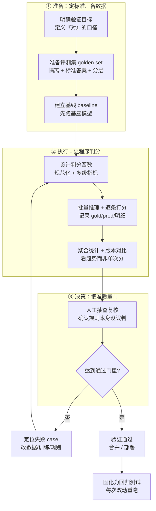

大模型微调结果验证

如果是新对话进入 /mnt/d/opt/lora_learn ，请重新激活python虚拟环境

```shell
source .venv/bin/activate
```

# 基本对话

## 基座能力测试

启动命令行对话测试

```shell
llamafactory-cli chat configs/chat_base.yaml
```

chat_base.yaml 的内容：

```yaml
### 对话配置①：纯基座模型（不加载任何 LoRA）
### 用途：冒烟测试第一步，确认基座模型本身能正常加载、能对话
### 命令：llamafactory-cli chat configs/chat_base.yaml
model_name_or_path: /mnt/d/opt/lora_learn/models/Qwen3-0.6B
template: qwen3                # 关键①：必须用 qwen3（ReasoningTemplate），不是 qwen3_nothink
enable_thinking: false         # 关键②：强制关闭思考，输出直接答案
infer_backend: huggingface     # CPU 只能用 huggingface 后端，不要用 vllm
trust_remote_code: true
```

对话结果：

````text
Loading weights: 100%|█████████████████████████████████████████████████████████████████████████████████████████████████| 311/311 [00:00<00:00, 1105.24it/s]
[INFO|configuration_utils.py:978] 2026-11-27 09:14:45,175 >> loading configuration file /mnt/d/opt/lora_learn/models/Qwen3-0.6B/generation_config.json
[INFO|configuration_utils.py:1027] 2026-11-27 09:14:45,175 >> Generate config GenerationConfig {
  "bos_token_id": 151643,
  "do_sample": true,
  "eos_token_id": [
    151645,
    151643
  ],
  "pad_token_id": 151643,
  "temperature": 0.6,
  "top_k": 20,
  "top_p": 0.95
}

[INFO|dynamic_module_utils.py:406] 2026-11-27 09:14:45,176 >> Could not locate the custom_generate/generate.py inside /mnt/d/opt/lora_learn/models/Qwen3-0.6B.
[INFO|2026-11-27 09:14:45] llamafactory.model.model_utils.attention:144 >> Using torch SDPA for faster training and inference.
[INFO|2026-11-27 09:14:45] llamafactory.model.loader:144 >> all params: 596,049,920
Welcome to the CLI application, use `clear` to remove the history, use `exit` to exit the application.

User: 你是谁
Assistant: 我是你的智能助手，专注于提供帮助和解答问题。如果你有任何问题或需要支持，请随时告诉我！
User: 给出查询SQL。\n\n数据库：电商订单库\n表结构：\n表 orders(id INT, user_id INT, product TEXT, amount REAL, order_date TEXT, status TEXT)\n表 users(id NT, name TEXT, city TEXT, vip INT)"："列出金额低于 26 元的订单编号和金额"
Assistant: 你可以使用以下 SQL 查询来实现你的需求：

```sql
SELECT id, product, amount, order_date, status
FROM orders
WHERE amount < 26.0;
```

这个查询将返回所有订单编号、产品名称、金额、订单日期和状态，其中金额低于 26 元的订单。
````

Web版的启动

```shell
llamafactory-cli webchat configs/chat_express.yaml
```

ps: 这里用的Python3.13 报错：

原因是按 **PEP 594**，Python 从 3.13 起把 `audioop` 从标准库**移除**了。连锁反应是：

`pydub` 需要 `audioop` → `Gradio`（Web 界面框架）依赖 `pydub` → `webchat` 一导入 Gradio 就崩

gradio 也需要升级

解决方案是安装对应包：

```shell
uv pip install audioop-lts
uv pip install --upgrade "gradio==5.50.0"

python3 -c "import gradio as gr; print('gradio', gr.__version__, 'OK')"   # 验证
python3 -c "import audioop; print('OK')"   # 输出 OK 即可
llamafactory-cli webchat configs/chat_express.yaml
```

web对话地址：

```shell
终端提示 Running on local URL: http://127.0.0.1:7860，浏览器打开这个地址，是一个聊天窗口，顶部能选模型/参数。
```


**为什么还是有thinking？**

Qwen3-0.6B 的权重出厂就是"思考模型"，当配置错误或者未配置就会有思考模式。

# lora加载对话

同样是使用配置文件的方式：

```shell
llamafactory-cli chat configs/chat_text2sql.yaml
```

chat_text2sql.yaml 的内容：

```yaml
### 对话配置②：基座 + text-to-sql LoRA 适配器
### 用途：冒烟测试第二步，确认 LoRA 能正常加载、能对话
### 命令：llamafactory-cli chat configs/chat_text2sql.yaml
### Web版：llamafactory-cli webchat configs/chat_text2sql.yaml
### 注意：adapter_name_or_path 指向 checkpoint-100（当前唯一产物）；
###       若之后训练完整结束出现根目录 adapter_model.safetensors，可改指向根目录。
model_name_or_path: /mnt/d/opt/lora_learn/models/Qwen3-0.6B
adapter_name_or_path: /mnt/d/opt/lora_learn/outputs/lora_text2sql/checkpoint-100
template: qwen3_nothink
infer_backend: huggingface
trust_remote_code: true
```

web界面的输入输出：

```text
输入：你是谁
输出：SELECT * FROM users;
输入：给出查询SQL。\n\n数据库：电商订单库\n表结构：\n表 orders(id INT, user_id INT, product TEXT, amount REAL, order_date TEXT, status TEXT)\n表 users(id NT, name TEXT, city TEXT, vip INT)"："列出金额低于 26 元的订单编号和金额"
输出：SELECT id, amount FROM orders WHERE amount <; 26;
```

**实际感受**：

- 速度提升明显，且通用的一些知识性质回答丢失了。
- 复杂sql，即多张表关联+聚合+分组排序，原有模型回答会陷入死循环或者非常慢（且最后的结果是错误的）。经过微调之后，能迅速给出正确答案。

**启动后对外暴露的大模型对话api接口是什么？**

- 默认监听：`127.0.0.1:8000`（不同版本/启动方式端口可能不同，以终端日志为准）
- 想外网 IP 直接访问，启动时要绑 `0.0.0.0`，用环境变量：

```
API_HOST=0.0.0.0 API_PORT=8000 llamafactory-cli api qwen3_infer.yaml
```

或者封装为sh脚本：

```sh
#!/bin/bash
export API_HOST=0.0.0.0
export API_PORT=8000
export CUDA_VISIBLE_DEVICES=0
exec llamafactory-cli api qwen3_infer.yaml
```

# 验证方案

验证效果很关键，**一般情况不是人工一条条看**。业界验证微调效果，主要有下面几类方式。

| 方式                  | 怎么做                                                   | 优点                             | 局限                                                                | 适合本实验吗                             |
| --------------------- | -------------------------------------------------------- | -------------------------------- | ------------------------------------------------------------------- | ---------------------------------------- |
| **① 规则/程序化校验** | 用代码比对输出与标准答案：精确匹配、字段比对、能否被解析 | 全自动、零成本、可复现、秒出结果 | 只适合**有标准答案**的任务                                          | ✅ **最适合**（SQL 和 JSON 都有唯一答案） |
| **② 传统 NLP 指标**   | BLEU / ROUGE / BERTScore 比对文本相似度                  | 成熟、有现成库                   | 只看字面相似，语义对了措辞不同也判错；SQL/JSON 这种结构化输出不适合 | ❌ 不适合                                 |
| **③ 任务专属指标**    | SQL 用执行准确率(EX)、组件匹配(CM)；抽取用字段级 P/R/F1  | 贴合任务本质，业界标准           | 需要实现或用专门评测集                                              | ✅ 可借鉴（本实验做了简化版）             |
| **④ LLM-as-a-Judge**  | 用更强的模型（如 GPT-4）给回答打分                       | 能评开放式、无标准答案的任务     | 需要更强的模型+API 费用；评判本身有偏差                             | ❌ 杀鸡用牛刀                             |
| **⑤ 公开 Benchmark**  | MMLU / C-Eval / CMMLU 等综合考卷                         | 测通用能力是否退化               | 与本任务无关；v0.9.5 的 `eval` 命令已废弃（见下方）                 | ❌ 不适合                                 |
| **⑥ 人工评测**        | 人逐条看、打分                                           | 最可信，是最终金标准             | 慢、贵、不可规模化                                                  | ⚠️ 只做少量抽检                          |

## 程序化验证的思路



## 本地脚本验证的思路

- **本地脚本执行阶段**
  - 核心思路：先规范化、再分级比对，不拿模型输出与标准答案做字符串硬比
  - 先把两者清洗成同一套表示，消除与语义无关的差异，再逐层判分
  - 原因：模型输出常带格式噪声（多空格、大小写、结尾分号、markdown 围栏），硬比会把“写法不同但答案正确”误判成错误，导致分数失真
- **SQL 清洗：固定流水线**
  - 依次处理：`strip` 去首尾空白 → 剥掉 `  ```sql  ` 围栏 → 去行尾分号 → 压缩操作符与逗号两侧空格（`age > 18` → `age>18`）→ 连续空白压成单个空格 → 整体转小写
  - 效果：`SELECT Name, Age FROM T` 与 `select name,age from t` 视为一致
  - 设计取舍：只动操作符和空白，不碰字符串字面量内部空格，不解析语法树
    - 因此列别名不同、SELECT 列顺序调换等语义等价情况仍会判错，这正是需要第二层指标的原因
- **第二层：组件匹配**
  - 按 SELECT、FROM、WHERE、GROUP BY、ORDER BY、HAVING、LIMIT 切段，逐段比对，按字段级 F1 汇总
  - 比精确匹配宽松，能识别“大部分组件都对、只有一处不同”，也能容忍子句顺序差异
  - 输出同时给 EM 和组件 F1：EM 低但 F1 高，说明模型学会了只是写法不同，该检查判分口径而非急着重训
- **快递 JSON 处理：容错提取**
  - 解析步骤：剥离围栏直接 `json.loads` → 失败则抓第一个 `{` 到最后一个 `}` 再解析 → 再失败判为格式错误（对应可解析率）
  - 解析成功后：检查 10 个字段齐全率 → 逐字段转字符串并 `strip` 后比对得字段级准确率 → 统计全对率
  - 字段比对做 `strip` 是为容忍“张三”与“ 张三 ”的纯空白差异
  - 刻意把“格式对”和“内容对”分开报告：可解析率 100% 只说明是合法 JSON，不代表值抽对了，混淆会严重高估效果
- **整体落点与代价**
  - 用规范化消除无意义差异避免误判，用多级指标把失败定位到具体层面（格式崩 / 字段漏 / 值错），用明细记录保留 gold、pred 与各维得分供人工复核判分规则是否过严
  - 代价：规范化规则需随任务调整，换任务时清洗流水线和字段清单都要重新设计，不能照搬

**评估结果**

```text
【text2sql】
  基座    : 条数=64 | 规范化精确匹配EM=62.5% | 组件匹配F1=78.9%
  LoRA  : 条数=64 | 规范化精确匹配EM=100.0% | 组件匹配F1=100.0%

【express】
  基座    : 条数=60 | JSON可解析率=100.0% | 字段齐全率=100.0% | 字段值准确率=84.5% | 整条全对率=3.3%
  LoRA  : 条数=60 | JSON可解析率=100.0% | 字段齐全率=100.0% | 字段值准确率=99.8% | 整条全对率=98.3%
```

## 有木有工具方便验证？

以下是常见的工具，一般而言的简单任务使用自定义脚本验证也可以。

| 工具        | 许可证        | 版本（2026-11 核实）                 | 语言                   | 自定义判分接口                                       | 适合          |
| --------- | ---------- | ------------------------------ | -------------------- | --------------------------------------------- | ----------- |
| DeepEval  | Apache-2.0 | 4.3.6（Python ≥3.10）            | Python               | 继承 `BaseMetric`，实现 `measure()`                | CI 回归门禁     |
| Promptfoo | MIT        | Node/CLI（PyPI 上那个 0.2.0 不是官方包） | Node + 自定义 Python 断言 | YAML 里 `type: python` + `value: file://...py` | 版本横评、A/B 对照 |

> 来源：PyPI 元数据（deepeval 4.3.6 / license Apache-2.0 / requires_python `<4.0,>=3.10`）；Promptfoo 官方断言文档（支持 `equals`/`is-json`/`is-sql`/`contains-json` 等确定性断言和 `type: python` 自定义脚本）。


## 更多启动配置

```yaml
# ============================================================
# LLaMA-Factory × Qwen3 系列 对话/API 推理配置（含 thinking 控制）
# 适用：Qwen3-4B/8B/14B/32B-Instruct-2507、Qwen3-Base、Qwen3-LoRA
# 命令：
#   llamafactory-cli chat     qwen3_infer.yaml
#   llamafactory-cli webchat  qwen3_infer.yaml
#   API_PORT=8000 llamafactory-cli api qwen3_infer.yaml
# ============================================================

### 1. 模型本体
model_name_or_path: Qwen/Qwen3-8B            # 或本地 /data/models/Qwen3-8B
template: qwen3                                # ★ Qwen3 标准模板（带 thinking 能力）
# template: qwen3_nothink                      # ★ 强制关闭 thinking 的模板（官方 example 用这个跑纯对话）[4](@ref)
trust_remote_code: true

### 2. 适配器（微调过才加）
# finetuning_type: lora
# adapter_name_or_path: saves/qwen3_lora/sft

### 3. 推理后端
infer_backend: huggingface                     # huggingface | vllm
infer_dtype: bf16                              # A100/H100 用 bf16，V100 用 fp16

### 4. Qwen3 专属：thinking 开关
# 方式 A（推荐，细粒度）：template 用 qwen3，运行时按请求传
#   - chat/webchat 交互里：在输入前加 /think 或 /no_think（部分前端支持）
#   - API 调用时：chat_template_kwargs={"enable_thinking": true/false}
#     （vLLM ≥0.9 原生支持；HF 后端走 LLaMA-Factory 的 generate 参数透传）[2](@ref)
enable_thinking: true                          # 全局默认值；API 单次请求可覆盖

# 方式 B（省事，永久关）：直接把 template 换成 qwen3_nothink
#   此时 enable_thinking 被模板忽略，输出永远不带 <think> 段 [4](@ref)

### 5. vLLM 专属（infer_backend: vllm 时）
vllm_gpu_util: 0.85
vllm_maxlen: 32768                             # Qwen3 默认 max_position_embeddings=40960，显存紧就降到 8192/16384 [2](@ref)
vllm_enforce_eager: false
# vllm_config: '{"gpu_memory_utilization":0.85,"max_model_len":32768,"enforce_eager":false}'

### 6. 采样参数（thinking 开着时建议松一点，给推理留 token）
temperature: 0.6
top_p: 0.95
top_k: 20
max_new_tokens: 32768                          # thinking 模式吃 token 多，别设 512 那种 [2,5](@ref)

# ============================================================
# 变体 A：Qwen3 原生 + thinking 开（数学/代码/复杂推理）
# ------------------------------------------------------------
model_name_or_path: Qwen/Qwen3-8B
template: qwen3
enable_thinking: true
infer_backend: vllm
infer_dtype: bf16
vllm_gpu_util: 0.85
vllm_maxlen: 32768
max_new_tokens: 32768
temperature: 0.6
top_p: 0.95

# ============================================================
# 变体 B：Qwen3 纯对话（永远不吐 <think>，延迟低）
# ------------------------------------------------------------
model_name_or_path: Qwen/Qwen3-8B
template: qwen3_nothink
infer_backend: huggingface
infer_dtype: bf16
max_new_tokens: 2048
temperature: 0.7

# ============================================================
# 变体 C：Qwen3-LoRA 微调模型 + 按请求切 thinking
# ------------------------------------------------------------
model_name_or_path: /data/models/Qwen3-8B
adapter_name_or_path: saves/qwen3_lora/sft
finetuning_type: lora
template: qwen3
enable_thinking: false          # 默认关；API 里某次要推理就传 enable_thinking=true 覆盖
infer_backend: vllm
vllm_gpu_util: 0.85
vllm_maxlen: 16384

# ============================================================
# 变体 D：Qwen3-VL 多模态
# ------------------------------------------------------------
model_name_or_path: Qwen/Qwen3-VL-4B-Instruct
template: qwen3_vl
infer_backend: huggingface
trust_remote_code: true
visual_inputs: true

# ============================================================
# API 调用时怎么切 thinking（OpenAI 兼容）
# ------------------------------------------------------------
# from openai import OpenAI
# client = OpenAI(api_key="0", base_url="http://0.0.0.0:8000/v1")
# resp = client.chat.completions.create(
#     model="Qwen/Qwen3-8B",
#     messages=[{"role":"user","content":"证明 √2 是无理数"}],
#     extra_body={"chat_template_kwargs": {"enable_thinking": True}},   # 单次开
# )
# 关掉就传 False；yaml 里的 enable_thinking 只是兜底默认值 [2,4](@ref)

# ============================================================
# 坑位提醒
#   - template 写 qwen（老 Qwen2.5 那套）跑 Qwen3 → thinking 标记不生效，容易乱回
#   - qwen3_nothink 下再传 enable_thinking=true 也没用，模板已经把 think 段裁了
#   - thinking 开着 max_new_tokens 给太小 → 答案被截断在 <think> 里
#   - vLLM OOM：先降 vllm_maxlen，再降 vllm_gpu_util，最后才 enforce_eager [2](@ref)
# ============================================================
```
