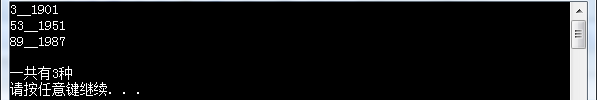

/*“1898–要发就发”。请将不超过1993的所有素数从小到大排成第一行，第二行上的每个素数都等于它右肩上的素数之差。  
编程求出：第二行数中是否存在这样的若干个连续的整数，它们的和恰好是1898？假好存在的话，又有几种这样的情况？  
第一行：2 3 5 7 11 13 17……1979 1987 1993  
第二行：1 2 2 4 2 4…… 8 6  
首先从数学上分析该问题：  
假设第一行中的素数为n[1]、n[2]、n[3]….n[i]、…第二行中的差值为m[1]、m[2]、m[3]…m[j]…。其中m[j]为：  
m[j]=n[j+1]-n[j]。  
则第二行连续N个数的和为：  
SUM=m[1]+m[2]+m[3]+…+m[j]  
=(n[2]-n[1])+(n[3]-n[2])+(n[4]-n[3])+…+(n[j+1]-n[j])  
=n[j+1]-n[1]  
由此题目就变成了：在不超过1993的所有素数中是否存在这样两个素数，它们的差恰好是1898。若存在，则第二行中必有所需整数序列，其和恰为1898。  
对等价问题的求解是比较简单的。  
由分析可知，在素数序列中不必包含2，因为任意素数与2的差一定为奇数，所以不必考虑。  
*/  

```c
#include"stdio.h"
#include"stdlib.h"
int main()
{int a[1994],num=0;//a用来保存素数表,是素数就保存素数的值,不是则存为0即可
    for(int i=0;i<1994;i++) a[i]=0;
    for(int i=3;i<=1993;i++)
    { int key=1;//key=1是表示是素数
        for(int j=2;j<=i/2;j++)
        if(i%j==0) {key=0; break; }
        if(key) a[i]=i;
    }
    //for(int i=0;i<1994;i++)
    //if(a[i]) printf("%d  ",a[i]);
    for(int i=3;i<1994;i++)//被减数一定大于1898+3
    {  for(int j=1898+3;j<1994;j++)
        if(a[j]-a[i]==1898)
        {//for(int k=i;k<=j;k++)
            //if(a[k])
            printf("%d__%d\n",a[i],a[j]);
            num++;
            //printf("\n");
        }
    }
    printf("\n一共有%d种\n",num);
    system("pause");}
```


