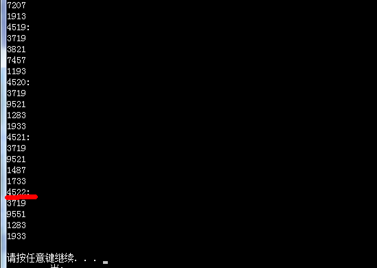
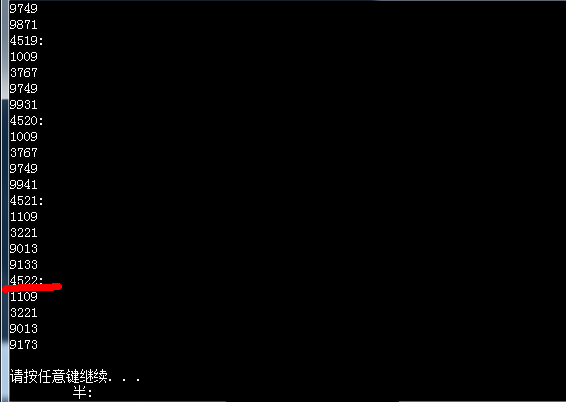

//求四阶的素数幻方。即在一个4X4 的矩阵中，每一个格填入一个数字，使每一行、每一列和两条对角线上的4个数字所组成的四位数，均为可逆素数。  
//求四位的可逆素数  

```c
#include"stdio.h"
#include"stdlib.h"
int zz=0;
int quzhi(int *a,int k)//将k分解成4位存在a中
{a[0]=k/1000;
    a[1]=k/100%10;
    a[2]=k/10%10;
    a[3]=k%10;
    return 1;
}
int qiuzhi(int a,int b,int c,int d)//将a中的数还原为一个四位数
{return(a*1000+b*100+c*10+d);
    //return(d*1000+c*100+b*10+a);
}

int main()
{int a[9000];//建立一张素数的表
    int i,j,k,l=0,num=0;//num为素数的总数
    int p[300][5];//用一个指针来保存每一个四位的可逆素数,p[x][1]之后用来保存每一位
    for( i=1000;i<=9999;i++)
    {int key=1;//key等于1时表示是素数
        for(j=2;j<=i/2;j++)
        { if(i%j==0){ key=0; break;} }
        if(key){ a[l++]=1; }
        else a[l++]=0;
    }
    for(i=1000;i<=9999;i++)
    {
        if(a[i-1000])
        { j=1; k=0;
            while(j<=1000)
            { k=k+(i%(j*10)/j)*1000/j;//k存储的是逆序后的数
                j=j*10;}
            if(i>=k&&a[k-1000])//直接在素数表中查询即可,这里防止重复输出
            {a[i-1000]=i;
                a[k-1000]=k;
                p[num++][0]=i;
                quzhi(&p[num-1][1],i);//建立每一位的表,提高效率
                p[num++][0]=k;
                quzhi(&p[num-1][1],k);
                // printf("%d_%d  ",a[i-1000],k);
                //if(++num%5==0) printf("\n");
            }
        }
    }
    for(i=1000;i<=9999;i++)
    if(a[i-1000]==1) a[i-1000]=0;//建立一张可逆素数的"布尔"表
    for(int t1=0;t1<num;t1++)//t1表示第一列
    {for(int k1=0;k1<num;k1++)//每一行的数字
        {if(p[t1][1]!=p[k1][1]) continue;
            for(int k2=0;k2<num;k2++)
            { if(p[t1][2]!=p[k2][1]) continue;
                for(int k3=0;k3<num;k3++)
                { if(p[t1][3]!=p[k3][1]) continue;
                    for(int k4=0;k4<num;k4++)
                    {if(p[t1][4]!=p[k4][1]) continue;
                        int key=1,r[4];//r用来保存每一列的数字
                        int zuoduijiao=qiuzhi(p[k1][1],p[k2][2],p[k3][3],p[k4][4])-1000;
                        int youduijiao=qiuzhi(p[k1][4],p[k2][3],p[k3][2],p[k4][1])-1000;
                        r[0]=qiuzhi(p[k1][1],p[k2][1],p[k3][1],p[k4][1])-1000;
                        r[1]=qiuzhi(p[k1][2],p[k2][2],p[k3][2],p[k4][2])-1000;
                        r[2]=qiuzhi(p[k1][3],p[k2][3],p[k3][3],p[k4][3])-1000;
                        r[3]=qiuzhi(p[k1][4],p[k2][4],p[k3][4],p[k4][4])-1000;//经过验证,计算对角和每一列的公式完全没有问题
                        if(!a[zuoduijiao]||!a[youduijiao]){ key=0;continue;}//两个对角线
                        if((!a[r[0]])) {key=0;continue;}//验证第一列
                        if((!a[r[1]])){key=0;continue;}//验证第2列
                        if((!a[r[2]])){key=0;continue;}//验证第3列
                        if((!a[r[3]])){key=0;continue;}//验证第4列
                        if(key)
                        printf("%d:\n%d\n%d\n%d\n%d\n",++zz,p[k1][0],p[k2][0],p[k3][0],p[k4][0]);//zz统计总的个数
                    }//end k4
                }//end k3
            }//end k2
        }//end k1
    }//end t1
    printf("\n");
    system("pause");
}
```




