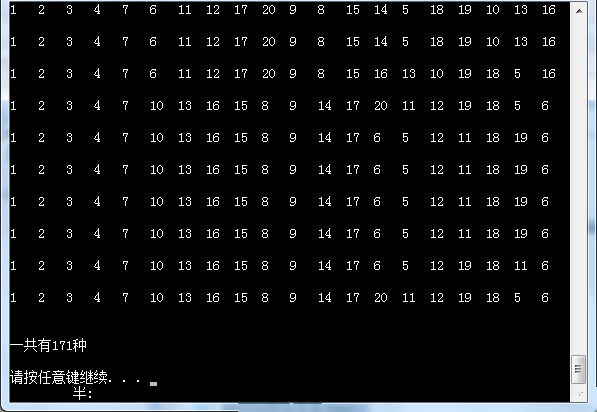

```c
//从1到20个数字排成一圈,每两个相邻数字之和为一个素数
#include"stdio.h"
#include"stdlib.h"
int zhongshu=0;//统计总数
int shusu(int b[20])
{int k=1;
    for(int i=0;i<20;i++)
    b[i]=0;//全部初始化为0
    b[0]=2;
    for(int i=3,j=2;i<=37;i++)
    { for(j=2;j<=i;j++)
        if(i!=j&&i%j==0)
        break;
        else if(j>=i)
        b[k++]=i;
    }
    //for(int i=0;i<k;i++)
    //printf("%-3d",b[i]);
    return k; }
int isshusu(int x,int y,int b[],int k )
{int key=0;
    for(int i=0;i<k;i++)
    if((x+y)==b[i])
    {key=1;
        break;}
    //if(key)
    //printf("__%d+%d__是素数=%d\n",x,y,x+y);
    return key;
}//判断两个数之和是否是素数
int pailie20(int a[21],int b[],int k,int n)
{//for(int i=0;i<k;i++)
    //printf("%-3d",b[i]);
    if(n>=20)
    {  if((a[20]+a[19]%2!=0)&&isshusu(a[20],1,b,k)&&isshusu(a[20],a[19],b,k))
        {for(int w=0;w<20;w++)  printf("%-4d",a[w]);
            printf("\n"); zhongshu++;}
        return 1;
    }
    for(int i=2;i<=20;i++)
    {int key=1;
        for(int j=0;j<n-1;j++)
        {if(a[j]==i)
            key=0;
        }
        if((a[n-2]+i%2)&&key&&isshusu(a[n-2],i,b,k))
        { a[n-1]=i;
            pailie20(a,b,k,++n);
        }
    }
    return 1;
}
int main()
{int a[21],b[20],k;//a用来保存从1到21这几个数字,b用来保存素数,37以内
    a[0]=a[20]=1;//将两端初始化为一,相当于一个环
    k=shusu(b);//k+1为其中素数的个数
    pailie20(a,b,k,2);//2为深度,从第二层开始递归
    /*if(isshusu(5,20,b,k ))
    printf("shigeshusu");
    else printf("bushi ");//判断子函数是否正确*/
    printf("\n一共有%d种\n\n",zhongshu);
    system("pause");
    return 1;
}
//小结,在判断素数时用建立素数表的形式更加方便
/*
bool prime[40]={
    0,0,1,1,0,1,0,1,0,0,
    0,1,0,1,0,0,0,1,0,1,
    0,0,0,1,0,0,0,0,0,1,
    0,1,0,0,0,0,0,1,0,0
};类似于此种情况的表判断更加的好 */
```


