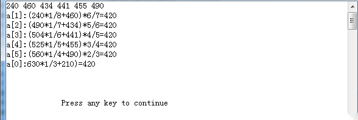

/* Note:Your choice is C IDE */  

```c
#include "stdio.h"
#include"stdlib.h"
void main()
{int father=2520;//
    int a[6],i;//a存储之前六人状态,b存储之后的状态
    float b[6],temp;

    for(a[0]=8;a[0]<1000;a[0]++)
    for(a[1]=7;a[1]<1000;a[1]++)
    {b[0]=a[0]*7.0/8.0;
        temp=b[0];
        b[1]=(a[0]*1.0/8.0+a[1]);
        if(b[1]*6.0/7.0!=420.0) continue;
        for(a[2]=6;a[2]<1000;a[2]++)
        {b[2]=(a[2]+b[1]*1.0/7.0);
            if(b[2]*5.0/6.0!=420.0) continue;
            for(a[3]=5;a[3]<1000;a[3]++)
            {b[3]=(a[3]+b[2]*1.0/6.0);
                if(b[3]*4.0/5.0!=420.0) continue;
                for(a[4]=4;a[4]<1000;a[4]++)
                {b[4]=(a[4]+b[3]*1.0/5.0);
                    if(b[4]*3.0/4.0!=420.0) continue;
                    for(a[5]=3;a[5]<1000;a[5]++)
                    {b[5]=(a[5]+b[4]*1.0/4.0);
                        if(b[5]*2.0/3.0!=420.0)
                        continue;
                        b[0]=b[0]+b[5]*1.0/3.0;
                        if(b[0]==420)
                        {for(i=0;i<6;i++)
                            printf("%d ",a[i]);
                            printf("\n");
                            //b[5]*=3.0/2.0;
                            b[0]=a[0];
                            temp=b[0]*7.0/8.0+b[5]*1.0/3.0;
                            //printf("\n%d\n",(int)b[5]);
                            for(i=1;i<6;i++)
                            {printf("a[%d]:(%d*%d/%d+%d)*%d/%d=%d\n",i,(int)b[i-1],1,9-i,a[i],7-i,8-i,(int)(b[i]*(7-i)/(8-i)));
                            }
                            b[0]=a[0]*7.0/8.0;
                            printf("a[0]:%d*%d/%d+%d)=%d\n",(int)b[5],1,3,(int)b[0],(int)temp);
                        }//end a[5]
                    }//end a[4]
```

          }//end a[3]

         } //end a[2]

     }//end a[1]  
}}
