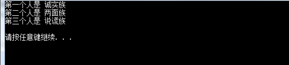

/*谜语博士遇到三个人，便问第一个人：“你是什么族的？”，回答：“诚实族的。”  
问第二个人： “你是什么族的？”答：“说谎族的。”博士又问第二个人：“第一个人真的是诚实族的吗？”，答：“是的。”  
问第三个人：“你是什么族的？”答：“诚实族的。”博士又问第三个人：“第一个人是什么族的？”，答：“两面族的。”  
请判断这个人到底是哪个民族的？  
(答案：第一个人是诚实族的，第二个人是两面族的，第三人是说谎族。)  
*/  

```c
#include"stdio.h"
#include"stdlib.h"
int main()
{int a[3];//用来保存三个人的身份,0是诚实族,1是说谎族,2是两面族
    char w[3][10]={{"诚实族"},{"说谎族"},{"两面族"}};
    char w1[3][12]={{"第一个人是 "},{"第二个人是 "},{"第三个人是 "}};
    for(a[0]=0;a[0]<3;a[0]++)
    {for(a[1]=0;a[1]<3;a[1]++)
        { if(a[0]!=a[1])
            {  if(a[1]==0) continue;
                if(a[1]==1) continue;
                for(a[2]=0;a[2]<3;a[2]++)
                {  if(a[0]!=a[1]&&a[1]!=a[2]&&a[2]!=a[0])
                    {if(a[2]==0) { if(a[0]!=2) continue; }//如果是诚实族
                        if(a[2]==1) { if(a[0]==2) continue; } //如果是说谎族
                        if(a[2]==2) { if(a[0]!=2) if(a[2]!=0) continue;}//如果本人是两面族
                        printf("%s%s\n%s%s\n%s%s\n",w1[0],w[a[0]],w1[1],w[a[1]],w1[2],w[a[2]]);
                    }
                }//end a[2]
            }
        }//end a[1]
    }//end a[0]
    printf("\n");
    system("pause");
}
```



原书上方法:

```c
*问题分析与算法设计
变量表示方法跟上题一样。

根据第一个人说真假话的不同，有：
真：a&&!aa||!a&&aa	（说真话，第一个人不是谎话族）
假：!a&&aa||!a&&!aa	（说假话，第一个人不是诚实族）

根据第二个人说真假话的不同，有：
真真：b&&!bb && !b&&!bb && a&&!aa			（两次都说真话，第二个人是诚实族）	X
真假：!b&&bb && !b&&!bb && (!a&&aa||!a&&!aa)		（一真一假，第二个人是两面族）		X
假真：!b&&bb && (b&&!bb||!b&&bb) && a&&!aa		（一假一真，第二个人是两面族）
假假：!b&&!bb && (b&&!bb||!b&&bb) && (!a&&aa||!a&&!aa)	（两次都说假话，第二个人是谎话族）	X

根据第三个人说真假话的不同，有：
真真：c&&!cc && c&&!cc && !a&&aa			（两次都说真话，第三个人是诚实族）
真假：!c&&cc && c&&!cc && (a&&!aa||!a&&!aa)		（一真一假，第三个人是两面族）		X
假真：!c&&cc && (c&&!cc||!c&&!cc) && !a&&aa		（一假一真，第三个人是两面族）		X
假假：!c&&!cc && (c&&!cc||!c&&!cc) && (a&&!aa||!a&&!aa)	（两次都说假话，第三个人是谎话族）

实际上，仔细观察会发现，第二个人说话的四种情况中，只有“假真”是唯一可能的，因为其他的表达式在化简后，含有b&&!b之类的值恒为0的表达式。于是推出，第二个人是两面族，第一个人是诚实族。这样可以简化判断条件。

同理，第三个人说话的四种情况中，“真假”是不可能的，因为表达式在化简后，含有!c&&c，值恒为0。那么，第三个人不是两面族。

在上面的完整条件后面，去掉一些恒不存在的情况，打上“X”表示。

另外，第一个人说假话的情况，!a&&aa||!a&&!aa可以化简为!a。

经过上述对判断条件的简化后，可以得到如下判断条件：
((a&&!aa||!a&&aa)||!a)&&
(!b&&bb && (b&&!bb||!b&&bb) && a&&!aa)&&
((c&&!cc && c&&!cc && !a&&aa)||(!c&&!cc && (c&&!cc||!c&&!cc) && (a&&!aa||!a&&!aa)))

*程序说明与注释
```

```c
#include <stdio.h>

void main()
{
	int a,b,c,aa,bb,cc;
	for(a=0;a<=1;a++)		//穷举全部情况
	{
		for(b=0;b<=1;b++)
		{
			for(c=0;c<=1;c++)
			{
				for(aa=0;aa<=1;aa++)
				{
					for(bb=0;bb<=1;bb++)
					{
						for(cc=0;cc<=1;cc++)
						{
							if(
								((a&&!aa||!a&&aa)||!a)&&
								(!b&&bb && (b&&!bb||!b&&bb) && a&&!aa)&&
								((c&&!cc && c&&!cc && !a&&aa)||(!c&&!cc && (c&&!cc||!c&&!cc) && (a&&!aa||!a&&!aa)))
								)
							{
								printf("The first man is %s.\n",aa?"double-dealing":(a?"honest":"lying"));
								printf("The second man is %s.\n",bb?"double-dealing":(b?"honest":"lying"));
								printf("The third man is %s.\n",cc?"double-dealing":(c?"honest":"lying"));
							}
						}
					}
				}
			}
		}
	}
}
```

`
