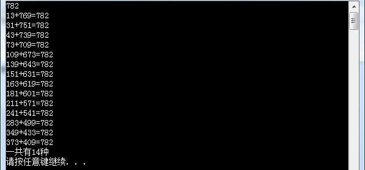

```c
//哥德巴赫猜想,2000以内的正偶数分解为两个素数之和
#include"stdio.h"
#include"stdlib.h"
int main()
{int i,j,k,a[1000],n=0;//用数组a存储2000以内的所有素数,n表示素数的个数
    for(i=2;i<2000;i++)
    {int key=1;//key=1的时候表示是素数
        for(j=2;j<=i/2;j++)
        if(i%j==0)
        {key=0; break; }
        if(key)
        {a[n]=i; n++; }
    }
    //for(int w=0;w<n;w++)
    //printf("%d_%d\n",a[w],w);
    scanf("%d",&k);//k必须大于等于4
    int w=0;
    for(i=0;i<n;i++)
    for(j=n-1;j>=i;j--)
    if(a[i]+a[j]==k)
    { printf("%d+%d=%d\n",a[i],a[j],k);
        w++;}
    printf("一共有%d种\n",w);
    system("pause");}
```


