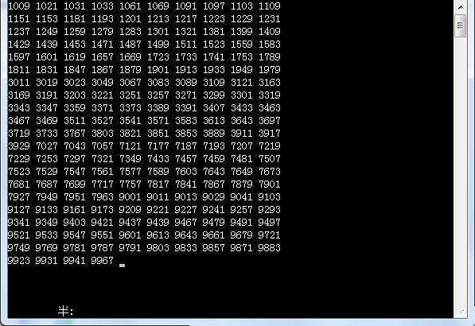

```c
//求四位的可逆素数
#include"stdio.h"
#include"stdlib.h"
int main()
{int a[9000];//建立一张素数的表
    int i,j,k,l=0,num=0;
    for( i=1000;i<=9999;i++)
    {int key=1;//key等于1时表示是素数
        for(j=2;j<=i/2;j++)
        { if(i%j==0){ key=0; break;} }
        if(key){ a[l++]=1; }
        else a[l++]=0;
    }
    for(i=1000;i<=9999;i++)
    {
        if(a[i-1000])
        {j=1;k=0;
            while(j<=1000)
            {k=k+(i%(j*10)/j)*1000/j;//k存储的是逆序后的数
                j=j*10;}
            if(a[k-1000])//直接在素数表中查询即可,这里防止重复输出
            {printf("%d  ",i);
                if(++num%10==0) printf("\n");
            } }
    }
    /*for(i=0;i<l;i++)
    {printf("%d_%d ",i+1000,a[i]);
        if((i+1)%8==0)
        printf("\n");}
    */
    printf("\n");
    system("pause");
}
```


