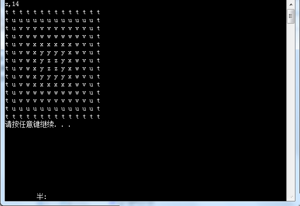

```c
/*回型方阵
输入首字符和高后，输出如图所示回型方阵。
A A A A A
A B B B A
A B C B A
A B B B A
A A A A A
*/
#include<cstdio>
#include"stdlib.h"
#include"math.h"
int small(int i,int j)
{if(i>j)
    return j;
    else return i;}//取较大的那个值
int main()
{char c;
    int n;
    //scanf("%c,%d",&c,&n);
    do
    {
        scanf("%c,%d",&c,&n);
    }while(c<'A'||c>'Z'&&c<'a'||c>'z');

    if(c+n/2>'z'&&c>'a')
    c='z'-(n-1)/2;
    else if(c+n/2>'Z'&&c<'Z')
    c='Z'-(n-1)/2;
    for(int i=1;i<=n;i++)
    { for(int j=1;j<=n;j++)
        {int t,k;
            t=i;
            k=j;
            if(i>(n+1)/2)
            t=n+1-i;
            if(j>(n+1)/2)
            k=n+1-j;
            int temp=small(t,k);
            //temp=t+k-temp;
            if(temp<0)
            temp=0-temp;
            printf("%c ",c+temp-1);
        }
        printf("\n");
    }
    system("pause");
    return 0;
}
//小结:但凡涉及到对称的问题,应当首先考虑n/2,(n+1)/2,(n-1)/2和正数负数的转换问题
```

  
