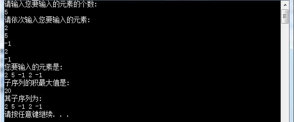

```c
//输入n个元素组成的序列S,找出最大的一个连续子序列,若乘积为正输出结果,否则输出-1(表示无解)
//1=<n<=18,-10<=s<=10
#include"stdio.h"
#include"stdlib.h"
void main()
{int n,s[20],a[20],cur;
    long int k,w=0;
    printf("请输入您要输入的元素的个数:\n");
    scanf("%d",&n);
    printf("请依次输入您要输入的元素:\n");
    for(int i=0;i<20;i++)
    a[i]=0;
    for(int i=0;i<n;i++)
    scanf("%d",&s[i]);
    printf("您要输入的元素是:\n");
    for(int i=0;i<n;i++)
    printf("%d ",s[i]);
    for(int i=0;i<n;i++)
    {k=1;
        for(int j=i;j<n;j++)
        {k=k*s[j];
            if(k>w)
            {cur=0;
                w=k;
                for(int t=i;t<=j;t++)
                a[cur++]=s[t];
        }}
    }
    if(w>=1)
    {printf("\n子序列的积最大值是:\n%ld",w);
        printf("\n其子序列为:\n");
        for(int t=0;t<w&&a[t];t++)
        printf("%d ",a[t]);
    }else printf("\n子序列的积最大值是:\n-1");
    printf("\n");
    system("pause");
}
```


