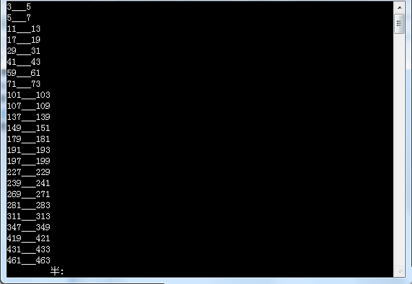

```c
//孪生素数,a和a+2皆为素数
#include"stdio.h"
#include"stdlib.h"
int main()
{int a[1001];//建立一张素数的表
    int i,j;
    for( i=2;i<=1000;i++)
    {int key=1;//key等于1时表示是素数
        for(j=2;j<=i/2;j++)
        { if(i%j==0){ key=0; break;} }
        if(key){ a[i]=1; }
        else a[i]=0;
    }
    for(i=2;i<=1000;i++)
    {if(a[i]&&a[i+2])
        printf("%d___%d\n",i,i+2);
    }
    printf("\n");
    system("pause");
}
```


