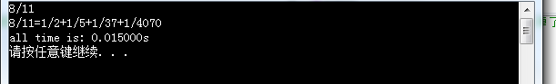
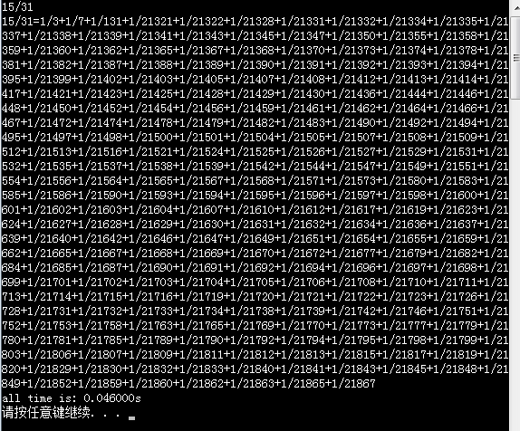

/*将真分数分解为埃及分数  
古埃及人所指的分数，其分子必等于1，例如：1/2、1/3、1/4。我们称这些分子等于1的分数为“埃及分数”。现输入一个真分数，请将该分数分解为埃及分数之和。  
如：8/11=1/2+1/5+1/37+1/4070。  
*问题分析与算法设计  
其实分法有多种，比如刚才的8/11，还可以分为8/11=1/2+1/5+1/55+1/110。但是我们规定一下分解原则：给定一个分数，总有一个少于它而且最接近它的埃及分数，故先找出这个埃及分数。例如：对于8/11，少于它而且最接近它的埃及分数是1/2。我们可以把8/11写成：  
8/11=1/2+5/22 少于而最接近5/22的埃及分数是1/5  
    =1/2+1/5+3/110 少于而最接近3/110的埃及分数是1/37  
    =1/2+1/5+1/37+1/4070  
1/2的来历是11/8+1=2，这个2做分母，得到一个埃及分数1/2。然后8/11-1/2=5/22，现在要把5/22分解。22/5+1=5，得到埃及分数1/5，5/22-1/5=3/110。110/3+1=37，得到埃及分数1/37，3/110-1/37=1/4070，结果刚好是一个埃及分数，故分解到此为止。  
总结：  
若真分数的分子a能整除分母b，则真分数直接经过化简就可以得到埃及分数。比如3/6，因为6%3=0，所以3/6=1/2。  
若真分数的分子不能整除分母，则可以从原来的分数中分解出一个分母为b/a+1的埃及分数。用这种方法将剩余部分反复分解，最后可得到结果。例子如上8/11的分解过程。  
注：原书上有一段关于a==3的判断处理，其实只是一种简单的优化。但是这个判断反而破坏了整个算法的统一性，故这里去掉了。  
*程序说明与注释  
# include<stdio.h>  
void main()  
{long int a,b,c;  
while(true)  
{ printf("Please enter a optional fraction(a/b):");  
scanf("%ld/%ld",&a,&b); //输入分子a和分母b  
printf("It can be decomposed to:");  
while(true)  
{if(b%a) //若分子不能整除分母  
c=b/a+1; //则分解出一个分母为b/a+1的埃及分数  
else{ c=b/a; a=1;} //否则，输出化简后的真分数(埃及分数)  
if(a==1)  
{printf("1/%ld\n",c);  
break; //a为1标志结束}  
else  
printf("1/%ld + ",c);  
a=a*c-b; //求出余数的分子  
b=b*c; //求出余数的分母  
}}}*/  
//下面给出笔者自己想到的一个方法,找到每一次小于a/b的离a/b得最近的分数,然后算出差值,继续循环,知道差值为0:  

//自己算了一下,131/191,31/111,31/133的结果会很长......

```c
#include"stdio.h"
#include"stdlib.h"
#include"time.h"
int k1,k2;//用来记录两个分数相减后的结果
long int gongbeishu(int a,int b)//求最小公倍数
{int temp;
    int k1=a,k2=b;
    while(a%b)
    {temp=a; a=b; b=temp%b; }
    return k1*k2/b;
}
int fenshucmp(int a,int b,int c,int d)
{return(a*(gongbeishu(d,b)/b)-c*(gongbeishu(b,d)/d));}//进行两个分数大小的比较
int fenshusub(int a,int b,int c,int d)
{k1=a*(gongbeishu(d,b)/b)-c*(gongbeishu(b,d)/d);//分子
    k2=gongbeishu(d,b);//分母
    return 1;}
int main()
{long int start,finish;
    int a,b;
    scanf("%d/%d",&a,&b);
    start=clock();
    printf("%d/%d=",a,b);
    for(int i=2;i<30000;i++)
    {if(fenshucmp(a,b,1,i)==0)
        {printf("%d/%d",1,i);
            break;
        }
        if(fenshucmp(a,b,1,i)>0)
        {fenshusub(a,b,1,i);
            printf("%d/%d+",1,i);
            a=k1; b=k2;
        }
    }//end for i
    finish=clock();
    printf("\n");
    printf("all time is: %lfs\n",(finish-start)/1000.0);
    system("pause");
}
```



  
