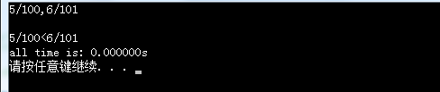

/*比较两个分数的大小。  
*问题分析与算法设计  
人工方式下比较分数大小最常用的方法是：进行分数的通分后比较分子的大小。可以编程模拟手式方式。  

```c
#include"stdio.h"
#include"stdlib.h"
#include"time.h"
long int gongbeishu(int a,int b)//求最小公倍数
{int temp;
    int k1=a,k2=b;
    while(a%b)
    {temp=a; a=b; b=temp%b; }
    return k1*k2/b;
}
int main()
{long int start,finish;
    int a,b,c,d;
    scanf("%d/%d,%d/%d",&a,&b,&c,&d);
    start=clock();
    if(a*(gongbeishu(d,b)/b)-c*(gongbeishu(b,d)/d)>0)
    printf("\n%d/%d>%d/%d",a,b,c,d);
    else if(a*(gongbeishu(d,b)/b)-c*(gongbeishu(b,d)/d)<0)
    printf("\n%d/%d<%d/%d",a,b,c,d);
    else printf("\n%d/%d=%d/%d",a,b,c,d);
    finish=clock();
    printf("\n");
    printf("all time is: %lfs\n",(finish-start)/1000.0);
    system("pause");
}
```

  
