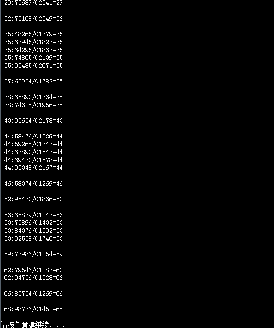

```c
//输入一个2<=n<=79的数,按从小到大求出abcde/fghij=n的所有情况,其中,a~j为0~9的一个排列
//下面的一些没用使用的代码可以看做是我思考时候的一些思路
#include"stdio.h"
#include"stdlib.h"
void main()
{int notaaa(int a[],int t,int y);
    int a[10],k,n=0,c[150][10],cur1=-1,cur2;//c数组用来保存每一次的结果然后排序输出,cur用来排序循环用
    long int w,m=0;
    //scanf("%d",&k);
    for(int k=2;k<79;k++)//这里采取全部选取的方法,省略输入过程
    {if(n){ printf("\n"); n=0;}//n用来控制输出的空行
        cur1=0;
        { for(a[0]=0;a[0]<=9;a[0]++)
            for(a[1]=0;a[1]<=9;a[1]++)
            {if(notaaa(a,0,1))
                continue;
                for(a[2]=0;a[2]<=9;a[2]++)

                { if(notaaa(a,0,2))
                    continue;
                    for(a[3]=0;a[3]<=9;a[3]++)
                    for(a[4]=0;a[4]<=4;a[4]++)
                    {
                        w=(a[0]+a[1]*10+a[2]*100+a[3]*1000+a[4]*10000)*k;
                        if(w>=99000)
                        continue;
                        a[5]=w%10;
                        a[6]=w%100/10;
                        if(notaaa(a,0,6))
                        continue;
                        a[7]=w%1000/100;
                        a[8]=w%10000/1000;
                        a[9]=w/10000;
                        if(notaaa(a,5,9))
                        continue;
                        if(!notaaa(a,0,9))
                        {n=1;
                            for(cur2=0;cur2<10;cur2++)
                            c[cur1][cur2]=a[cur2];
                            //printf("\n %d:",k);
                            //printf("%d%d%d%d%d/%d%d%d%d%d=%d",a[9],a[8],a[7],a[6],a[5],a[4],a[3],a[2],a[1],a[0],k);
                            cur1++;
                        }
        }}}}//这几重括号基本是对循环的一点点优化
        for(int i=0;i<cur1;i++)//对保存的结果进行排序
        for(int j=i;j<cur1;j++)
        //严格进行abcde几位数字的排序
        if((c[i][9]*10000+c[i][8]*1000+c[i][7]*100+c[i][6]*10+c[i][5])>(c[j][9]*10000+c[j][8]*1000+c[j][7]*100+c[j][6]*10+c[j][5]))
        for(int cur3=0;cur3<10;cur3++)
        {long int p;
            p=c[i][cur3];
            c[i][cur3]=c[j][cur3];
            c[j][cur3]=p;}
        for(int i=0;i<cur1;i++)
        {printf("\n %d:",k);
            printf("%d%d%d%d%d/%d%d%d%d%d=%d",c[i][9],c[i][8],c[i][7],c[i][6],c[i][5],c[i][4],c[i][3],c[i][2],c[i][1],c[i][0],k);
        }
    }
    printf("\n");
    system("pause");
}
//子函数完全没有问题
int notaaa(int a[],int t,int y)
{int i,j;
    for(i=t;i<=y;i++)
    for(j=t;j<=y;j++)
    { if(i!=j)
        if((a[i]==a[j]))
        return 1;
    }
    return 0;
}
```


