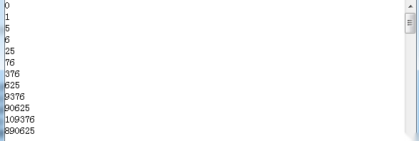

```c
#include"stdio.h"
#include"stdlib.h"
int main(){
    long int i,k,k1,k2,k3,mul;
    for(i=0;i<2000000;i++)
    {mul=0;k3=1;
        while(i/k3>0)
        k3=k3*10;
        for(k=1;i/k>0;k=k*10)
        {
            k1=i%(k3/k);//从首位尾依次到末位,其中首位依次减少一位,如123->23->3
            k2=i%(k*10)/k;//从末位到首位的每一位(依次)
            mul=mul+k1*k2*k;//k在这里可以同时表示k2的权,即系数10^k
            mul=mul%k3;
            //printf("%ld,%ld,%ld,%ld\n",i,k1,k2,mul);
        }
        if(i==mul)
        {printf("%ld\n",mul);
        }
}}
/*
/*被乘数最后三位*乘数的倒数第一位*其位上的权
被乘数最后二位*乘数的倒数第二位*其位上的权
被乘数最后一位*乘数的倒数第三位*其位上的权
*/
```


