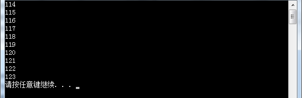

```c
//请找出十个最小的连续自然数，它们个个都是合数(非素数)
#include"stdio.h"
#include"stdlib.h"
int main()
{int k=0;//用于计数
    for(int i=2;i<30000;i++)
    { int key=1;//用于判断素数的标识,key=1的时候是素数
        for(int j=2;j<=i/2;j++)
        if(i%j==0){key=0; break; }
        if(!key) k++;
        else k=0;
        if(k==10)
        { for(int j=9;j>=0;j--)
            printf("%d\n",i-j); break;       }
    }
    system("pause");}
```


