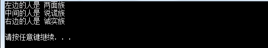

/*两面族是荒岛上的一个新民族，他们的特点是说话真一句假一句且真假交替。  
如果第一句为真，则第二句是假的；如果第一句为假的，则第二句就是真的，但是第一句是真是假没有规律。  
谜语博士遇到三个人，知道他们分别来自三个不同的民族：诚实族、说谎族和两面族。三人并肩站在博士前面。  
博士问左边的人：“中间的人是什么族的？”，左边的人回答：“诚实族的”。  
博士问中间的人：“你是什么族的？”，中间的人回答：“两面族的”。  
博士问右边的人：“中间的人究竟是什么族的？”，右边的人回答：“说谎族的”。  
请问：这三个人都是哪个民族的？  
*原书中问题分析与算法设计  
这个问题是两面族问题中最基本的问题，它比前面只有诚实族和说谎族的问题要复杂。解题时要使用变量将这三个民族分别表示出来。  
令：  
变量a=1表示：左边的人是诚实族(用C语言表示为a或者a&&!aa)；  
变量b=1表示：中间的人是诚实族(用C语言表示为b或者b&&!bb)；  
变量c=1表示：右边的人是诚实族(用C语言表示为c或者c&&!c)；  
变量aa=1表示：左边的人是两面族(用C语言表示为aa或者!a&&aa)；  
变量bb=1表示：中间的人是两面族(用C语言表示为bb或者!b&&bb)；  
变量cc=1表示：右边的人是两面族(用C语言表示为cc或者!c&&cc)；  
则左边的人是说谎族可以表示为：a!=1且aa!=1 (不是诚实族和两面族)  
用C语言表示为：!a&&!aa  
中间的人是说谎族可以表示为：b!=1且bb!=1  
用C语言表示为：!b&&!bb  
右边的人是说谎族可以表示为：c!=0且cc!=1  
用C语言表示为：!c&&!cc  

根据题目中“三人来自三个民族”的条件，可以列出：  
a+aa!=2&&b+bb!=2&&c+cc!=2 且 a+b+c==1&&aa+bb+cc==1  
a+aa!=2的意思是，左边的人不可能既是诚实族，又是两面族。b+bb!=2和c+cc!=2同理。  
a+b+c==1的意思是，三个人当中，只有一个是诚实族。  
aa+bb+cc==1的意思是，三个人当中，只有一个是两面族。  

根据左边人的回答可以推出：若他是诚实族，则中间的人也是诚实族；若他不是诚实族（是说谎族或两面族），如果是说慌族，则中间的人不是诚实族；如果是两面族，他可能说真话，也可能说谎话，故中间的人是什么族不能确定。  
a&&!aa&&b&&!bb||!a&&!aa&&!a||!a&&aa  

注：原书写的是“根据左边人的回答可以推出：若他是诚实族，则中间的人也是诚实族；若他不是诚实族，则中间的人也不是诚实族。以上条件可以表示为：a&&!aa&&b&&!bb||!a&&!b”，这个推断不对（虽然结果是对的）。  

根据中间人的回答可以知道：他不是诚实族的人。则可以用下列逻辑式表示：  
!b  
根据右边人的回答可以推出：若他是诚实族，则中间人是说谎族；若他是说谎族，中间的人就不是说谎族（是诚实族或两面族）；若右边的人是两面族，则中间的人是什么族不能确定。以上条件可以用下列逻辑表达式表示：  
c&&!b&&!bb||(!c&&!cc)&&(b||bb)||!c&&cc  
将全部逻辑条件联合在一起，利用穷举的方法求解，凡是使上述条件同时成立的变量取值就是题目的答案。  

*程序说明与注释  
# include <stdio.h>  

void main()  
{  
int a,b,c,aa,bb,cc;  
for(a=0;a<=1;a++) //穷举全部情况  
{  
for(b=0;b<=1;b++)  
{  
for(c=0;c<=1;c++)  
{  
for(aa=0;aa<=1;aa++)  
{  
for(bb=0;bb<=1;bb++)  
{  
for(cc=0;cc<=1;cc++)  
{  
if(a+aa!=2&&b+bb!=2&&c+cc!=2&& //判断逻辑条件  
(a+b+c==1&&aa+bb+cc==1)&&  
(a&&!aa&&b&&!bb||!a&&!aa&&!a||!a&&aa)&&  
!b &&  
(c&&!b&&!bb||(!c&&!cc)&&(b||bb)||!c&cc))  
{  
printf("The man stand on the left is %s.\n",  
aa?"double-dealing":(a?"honest":"lying"));  
printf("The man stand in the center is %s.\n",  
bb?"double-dealing":(b?"honest":"lying"));  
printf("The man stand on the right is %s.\n",  
cc?"double-dealing":(c?"honest":"lying"));  
}  
}  
}  
}  
}  
}  
}  
}  

*运行结果  
The man stand on left is double-dealing.  
The man stand on center is lying.  
The man stand on right is honest.  

*/  

//笔者思考的一个方法

```c
#include"stdio.h"
#include"stdlib.h"
#include"time.h"
int main()
{int a[3];//分别表示三人,诚实.说谎.两面族
    //用0,1,2,表示诚实.说谎.两面族
    char w[3][10]={{"诚实族"},{"说谎族"},{"两面族"}};
    char w1[3][12]={{"左边的人是 "},{"中间的人是 "},{"右边的人是 "}};
    int b;//保存中间那个人的身份,如果和叙述的相同,则输出结果
    for(a[0]=0;a[0]<3;a[0]++)
    {if(a[0]==0) b=0;//如果他是诚实族的,是真话
        for(a[1]=0;a[1]<3;a[1]++)
        {if(a[0]!=a[1])
            if(a[0]!=0&&a[1]==0) b=2;//a[1]说真话,那么a[0]必定说的是假话
            for(a[2]=0;a[2]<3;a[2]++)
            {   if(a[0]!=a[1]&&a[0]!=a[2]&&a[2]!=a[1])
                {if(a[2]==0&&a[0]!=0&&a[1]!=0)//a[2]说的真话,那么a[0]和a[1]都是说的假话
                    b=1;
                    if(b==a[1])
                    printf("%s%s\n%s%s\n%s%s\n",w1[0],w[a[0]],w1[1],w[a[1]],w1[2],w[a[2]]);}
            }//end [a2]
        }//end a[1]
    }//end a[0]
    printf("\n");
    system("pause");
}
```

  
