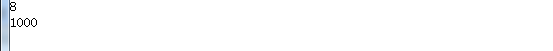

十进制转换为二进制  
/*  HELLO.C -- Hello, world */

```c
#include "stdio.h"
#include "conio.h"
#include"stdio.h"
main()
{long int a,b,c;
    scanf("%ld",&a);
    c=0;
    for(b=2;a>=b;b*=2)
    c++;
    b=b/2;
    for(;a>=0&&c>=0;c--)
    {if(a==0&&b==0) {printf("0"); break;}
        if(a-b<0) printf("0");
        else if(a-b>=0)
        {printf("1");
            a=a-b;}
        b=b/2;
    }
    getch();
}
```


