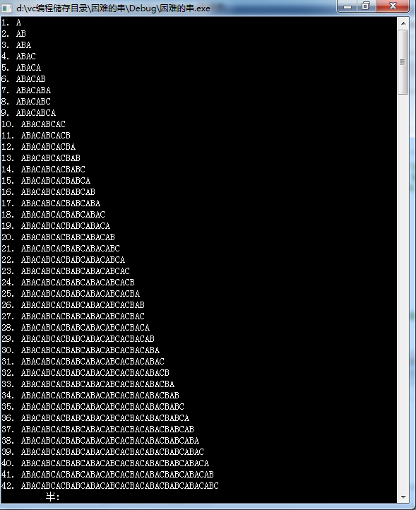

```c
/*
如果一个字符串包含两个相邻的重复字串，则称它是“容易的串”，其他串称为“困难的串”。例如，BB,ABCDACABCAB,ABCDABCD都是容易的，
而D,DC,ABDAB,CBABCBA都是困难的。输入正整数n和L，输出由前L个字符组成的，字典序第k小的困难的串。
例如，当L=3时，前7个困难的串分别为：A,AB,ABA,ABAC,ABACA,ABACAB,ABACABA.输入保证答案不超过80个字符。
样例输入：
7 3
30 3
样例输出：
ABACABA
ABACABCACBABCABACABCACBACABA
*/

//方法一:
```

```c
#include"stdio.h"
#include"stdlib.h"
int num=0;//统计总数走向
int main()
{   //dg(字符数组a,前L个字符,需要打印的总数n,数组的当前下标k)
void dg(char a[],int L,int n,int k);
	bool isdif(char a[],int length);
char a[1000];
dg(a,3,80,0); 
```

```c
system("pause");
	return 0;
}
//判断是否是困难的串
bool isdif(char a[],int length)
{
	bool ok=true;
```

```c
for(int i=0;i<length;i++)//每个字符以自己为中心,从开头判断到结尾
{ //以i为起点,以j为第二个子串起点,两个子串比较
	for(int j=i+1;j<length&&(length-j>=j-i);j++)
	{
	int all=0;
	  for(int k=0;k<j-i;k++)
	  { if(a[i+k]!=a[j+k])//不相等,那么这个子串是困难串
	    { all=1;
break;
	     }
	   }
	if(all==0)
	{ ok=false; break;}
```

    	}
    }

    return ok;
    }

```c
//由递归生成各种串
//dg(字符数组a,前L个字符,需要打印的总数n,数组的当前下标k)
void dg(char a[],int L,int n,int k){
if(num<=n)
{
for(int i=0;i<L;i++)
{ a[k]=char('A'+i);
if(num<n&&isdif(a,k+1))
{  num++;
printf("%d. ",num);
for(int j=0;j<=k;j++)
printf("%c",a[j]);
printf("\n");
dg(a,L,n,k+1);
}
}
}
```

    }

  
