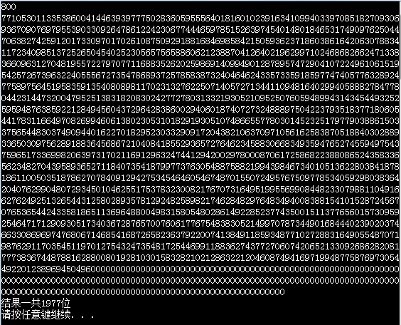

```c
#include"string.h"
#include"stdio.h"
#include"stdlib.h"
int main()
{int i,j,k,n=0,m=0;
    int a[3000];/*定义一个数组来存放各位,十位,百位......*/
    for(i=0;i<3000;i++)
    a[i]=0;
    a[0]=1;/* 因为0!=1且1!=1*/
    scanf("%d",&k);
    for(j=2;j<=k;j++)
    {n=0;/* n是在下个循环中存放进阶后的数字的,取余数,5+8=13中的1就是进阶后的数*/
        for(i=0;i<3000;i++)
        { m=a[i]*j+n;/*m用来存每一位与当前j的乘积的大小加上进阶的数,因为a[i]是变化的,所以*/
            a[i]=m%10;/*a[i]用来存放当前的最低位*/
            n=m/10;   }}

    for(i=3000;i>=0;i--)
    if(a[i]>0) {m=i;  break;
    }   /*存放所求数字的位数*/
    for(i=m;i>=0;i--)
    printf("%d",a[i]);
    printf("\n结果一共%d位\n",m+1);
    system("pause");
}
```


