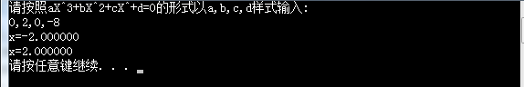

```c
#include"stdio.h"
#include"stdlib.h"
#include"math.h"
float min=0.000001,n=-5555;
int a,b,c,d;
double yy(double x)
{return(a*x*x*x+b*x*x+c*x+d);
}
double xpoint(double x1,double x2)
{//double x=(x1*yy(x2)-x2*yy(x1))/(yy(x2)-yy(x1));//求(x1,y1)与(x2,y2)两点连成的弦与x轴的交点的x的值
    int i=0;
    //if(yy(x1)*yy(x2)>0) return -5001;
    while(fabs(yy(x1))>min)
    {   if(fabs(x1-x2)<=min) break;
        if(yy((x1+x2)/2)*(yy(x1))>0)//yy((x1+x2)/2)和y1同号
        x1=(x1+x2)/2; else x2=(x1+x2)/2;
        //  if(i++%40==0)
        //printf("x1_%llf  x2_%llf  yy(x1)_%llf\n",x1,x2,yy(x1));
    }

    if(fabs(yy(x1))<=min&&(fabs(x1-n)>min))
    {n=x1;
        printf("x=%llf\n",x1);
        return x1;}
    else return 5001;
}
int main()
{double x1=-5000.0,x2=-5005.0,x3=5000.0;
    double add=0.1;
    printf("请按照aX^3+bX^2+cX^+d=0的形式以a,b,c,d样式输入:\n");
    scanf("%d,%d,%d,%d",&a,&b,&c,&d);
    while(x2<x3)
    {xpoint(x1,x2+min);
        x1+=add;
        x2+=add;
    }
    system("pause");}
```


