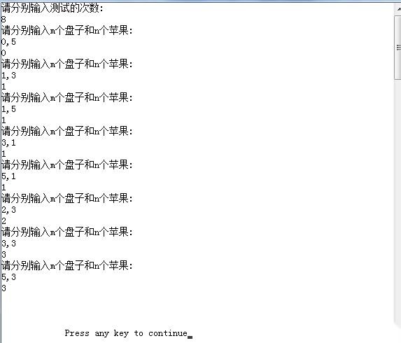

把M个同样的苹果放在N个同样的盘子里,允许有的盘是空盘子

/* Note:Your choice is C IDE */  

```c
#include "stdio.h"
#include"string.h"
int f(int m,int n ) //m个盘子,n个苹果
{
    if(m==1||n==0)
    return 1;//如果只有一个盘子了,当然只有一个方法了,如果没有苹果了,那么也只有空出所有盘子这种方法了
    if(m<=0||n<0)
    return 0;//如果盘子用完了,当然再也没有办法放苹果了,如果苹果是负数,苹果早就用完了,方法肯定是零了
    return (f(m,n-m)+f(m-1,n));//返回两种子情况,分别是把当前所有盘子放满后,剩余的n-m个苹果放在m个盘子的方法 + n个苹果放在m-1个盘子的方法,也就是空出一个盘子后的情况
}
int main () {
    int t, m, n,k;
    printf("请分别输入测试的次数:\n");
    scanf ("%d", &t);
    while (t--) {
        printf("请分别输入m个盘子和n个苹果:\n");
        scanf ("%d,%d", &m, &n);
        //if(m<n)
        //{k=m;m=n;n=k; }
        printf ("%d\n", f (m, n));
    }
    getchar();
    return 0;
}
```


