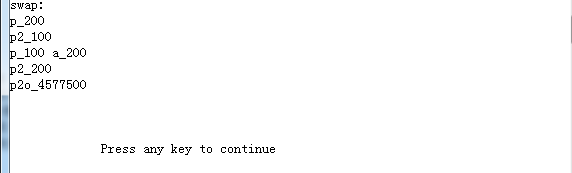
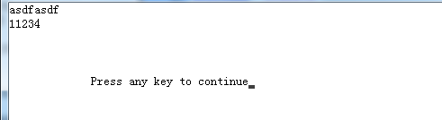
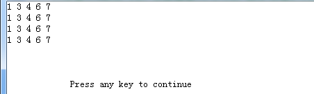

/* Note:Your choice is C IDE */  

```c
#include "stdio.h"
#include"malloc.h"
void swap(int *p1,int *p2)
{int *temp;
    temp=p1;
    p1=p2;
    p2=temp;
    printf("swap:\np_%d\n",*p1);//这里的地址相当于局部变量,只在这个函数内有效
    printf("p2_%d\n",*p2);//而采用int temp; temp=*p1;*p1=*p2;*p2=temp;则表示此地址所指向的值发生变化,影响全局
}//如果int *a; *a=5;这种情况是错误的,*P代表地址P所指向的值,这里地址a并没有初始化,所以指向不了
void main()
{
    int *p,a=200,*p2;
    p2=&a;
    p=(int *)malloc(sizeof(int));
    *p=100;
    swap(p,p2);
    printf("p_%d a_%d\n",*p,a);
    printf("p2_%d\n",*p2);
    printf("p2o_%0\n",*p2);//以八进制的方式输出地址
}
```



/* Note:Your choice is C IDE */  

```c
#include "stdio.h"
void main()
{char *p;
    int *p1;
    p="asdfasdf";
    p1=11234;
    printf("%s\n",p);
    printf("%d\n",p1);
}//这里相当于把"asdfasdf"的a的地址赋予给p,同样对于整形相当于把11234中1的地址给p1
//若写成*p="asdfasdf";是不对这,这样代表将一个字符串存放到指针变量p中,而指针变量只能存放地址
```



/* Note:Your choice is C IDE */  

```c
#include "stdio.h"
void main()
{int a[5]={1,3,4,6,7},i;
    int *p[5];//每一个数组元素存一个指针元素
    int **p1;
    for(i=0;i<5;i++)
    p[i]=&a[i];
    *p1=&a[0];

    for(i=0;i<5;i++)
    printf("%d ",*(p[i]));
    printf("\n");

    for(i=0;i<5;i++)
    printf("%d ",*((*p1)++));
    //这里*p1指向a[0],不能使用p1=&a[0],因为这里&a[0]
    //相当于一个一维地址,而**p是二维的
    printf("\n");

    p1=p;//p的值是p1[0],也就是&a[0],
    //p++的意思就是p指向一下个指针元素如从p1[0]变成p1[1]
    for(i=0;i<5;i++)
    printf("%d ",*(*(p1++)));
    printf("\n");

    p1=&a[0];
    for(i=0;i<5;i++)
    printf("%d ",(*(p1++)));
    printf("\n");
}
```



小结二:

```c
指针表示的是一个地址int *p;
中p才是指针,而*p表示的是p这个地址所指向的值,
所以改变p的值不会引起值得变化,(但是地址会变化)
但是改变*p的值那么p这个地址中代表的值就会发生变化
```

    下面:

```c
int insert(int a,List *list)
{  List *l;
// l=(List *)malloc(sizeof(List));
l=list;
// l->num=a; 
//printf("*L: %d\n",l->num);
while(l->next!=NULL)
{ l=l->next;
printf("l->next: %d\n",l->num);	
}
//printf("2*L: %d\n",l->num);
List *k;
k=(List *)malloc(sizeof(List));
l->next=k;//l->next是一个地址,但是这个地址现在没有被赋值,所以不能指向任何的值
List list2;//但是当这个地址被赋值为k这个刚刚开辟了空间(即初始化过的),便可以复制了,所以现在l-//>next的值便是k
//list2=(List *)malloc(sizeof(List));
list2.num=a;
list2.next=NULL;
*k=list2;//*k表示k这个地址指向的值是list2,k的地址和l->next的地址是相同的
return 0;
}//这里开辟的地址空间不会释放,所以k这个地址将会一直有效
//但是如果直接采用l->next=&list2将会产生错误,因为,变量list2的内存空间只在此次运行的int insert()这个内存空间中有效,也就是所在此次运行过后将会释放其所指向的空间
//使这个地址变成一个野地址,也就是错误的原因
```
