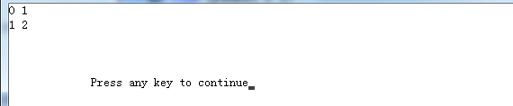
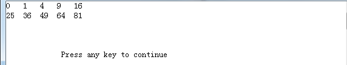

/* Note:Your choice is C IDE */  
# include "stdio.h"  
void main()  

```c
{int a[2][2],i,j;
int *p;
p=a;
for(i=0;i<2;i++)
{ for(j=0;j<2;j++)
{a[i][j]=i+j;
printf("%d ",*(p+i*2+j));
// printf("%d ",*(*(a+i)+j));
//printf("%-3d",a[i][j]);
}printf("\n"); }

}//小结,由于a为二维数组,所以printf("%-3d",a[i][j]);和 printf("%d ",*(*(a+i)+j));是等价的
```

//而当p指向a的首地址时,p是一维指针,所以不具备二维指针的特性,但是其地址的排列方式是相同的(按行排列),所以printf("%d ",*(p+i*2+j));与printf("%-3d",a[i][j]);

//和 printf("%d ",*(*(a+i)+j));是等价的



/* Note:Your choice is C IDE */  
# include "stdio.h"  

```c
void bianhuan(int a[][5])
{int i,j;
    for(i=0;i<2;i++)
    {for(j=0;j<5;j++)
        printf("%-4d",a[i][j]);
        printf("\n");}}
void main()
{int a[100],i,j;
    for(i=0;i<10;i++)
    a[i]=i*i;
    bianhuan(a);
}//同样可以利用这种方式将一串数字或者字符转换成二维数组的方式
```


