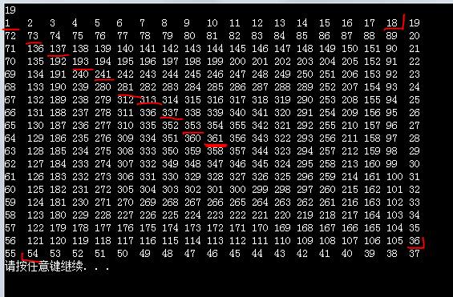

```c
//蛇形数组01
#include"stdio.h"
#include"stdlib.h"
int main()
{int aa,a,b,bb,n=0,temp=0;
    int k[100][100],num;//保存数组的结果
    for(int i=0;i<100;i++)
    for(int j=0;j<100;j++)
    k[i][j]=0;//初始化
    scanf("%d",&num);
    for(int j=1;j<=num;j+=2)//循环的圈数
    {b=a=j/2;//上行,左列
        bb=aa=num-j/2-1;//下行,右列
        for(int i=temp+1;i<=num*num;)
        {n=i-temp;
            if(n<=1*(aa-a)) for(int f=b;f<bb;f++){k[a][f]=i;i++;}//以下几行,严格按照蛇形数组的顺序递增的
            else if(n<=2*(aa-a)) for(int f=a;f<=aa;f++) {k[f][bb]=i;i++;}
            else if(n<=3*(aa-a)) for(int f=bb-1;f>b;f--) {k[aa][f]=i; i++;}
            else if(n<=4*(aa-a)) for(int f=aa;f>a;f--) {k[f][b]=i; i++;}
            else if(aa==a&&bb==b){ k[aa][bb]=i++;
                //break;
            }//这个是是num为奇数时的情况
            else break;
        }
        //temp=temp+num*(num-j+1)-4;
        temp=temp+(num-j)*4; //每一圈结束的数字
    }
    for(int i=0;i<num;i++)
    {for(int j=0;j<num;j++)
        printf("%-4d",k[i][j]);
        printf("\n");
    }
    system("pause");}
```


