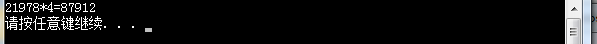

/*福尔摩斯到某古堡探险，看到门上写着一个奇怪的算式：

    ABCDE * ? = EDCBA

    他对华生说：“ABCDE应该代表不同的数字，问号也代表某个数字！”

    华生：“我猜也是！”

    于是，两人沉默了好久，还是没有算出合适的结果来。

    请你利用计算机的优势，找到破解的答案。

    把 ABCDE 所代表的数字写出来。*/

```c
#include"stdio.h"
#include"stdlib.h"
int main()
{long int a[5];
    for(int j=01234;j<98766;j++)
    for(int i=1;i<10;i++)
    {long int temp=i*j;
        if(temp>99999) continue;
        int key=1;
        a[4]=j*i/10000;
        a[3]=temp%10000/1000;
        a[2]=temp%1000/100;
        a[1]=temp%100/10;
        a[0]=temp%10;
        if(a[0]*10000+a[1]*1000+a[2]*100+a[3]*10+a[4]!=j)
        continue;
        for(int b=0;b<5;b++)
        for(int c=0;c<5;c++)
        if(b!=c&&a[b]==a[c])
        {key=0; break;
        }
        if(key)
        {printf("%ld*%d=",j,i);
            for(int b=4;b>=0;b--)
            printf("%d",a[b]);
            printf("\n");
        }//end if
    }
    system("pause");}
```


