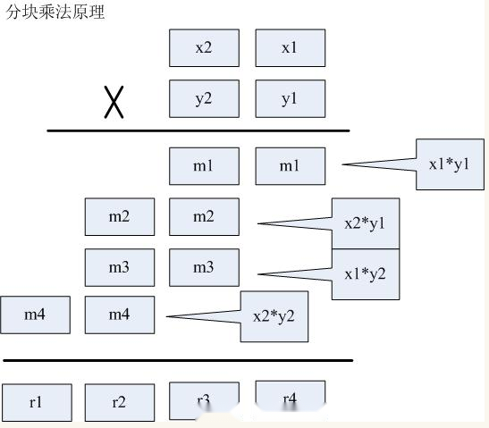

/*大数乘法  
对于32位字长的机器，大约超过20亿，用int类型就无法表示了，我们可以选择int64类型，但无论怎样扩展，  
固定的整数类型总是有表达的极限！如果对超级大整数进行精确运算呢？  
一个简单的办法是：仅仅使用现有类型，但是把大整数的运算化解为若干小整数的运算，即所谓：“分块法”。

*/  

```c
#include"stdio.h"
#include"stdlib.h"
void bigmul(int x, int y, int r[])
{int base = 10000;
    int x2 = x / base;
    int x1 = x % base;
    int y2 = y / base;
    int y1 = y % base;
    int n1 = x1 * y1;
    int n2 = x1 * y2;
    int n3 = x2 * y1;
    int n4 = x2 * y2;
    r[3] = n1 % base;
    r[2] = n1 / base + n2 % base + n3 % base; //这里可以将每一个数字的权看成是base
    r[1] =n2/base+n3/base+n4%base; // 填空
    r[0] = n4 / base;

    r[1] +=r[2]/base; // 填空,这里是r[2]的进位
    r[2] = r[2] % base;
    r[0] += r[1] / base;
    r[1] = r[1] % base;
}
int main()
{ int x[] = {0,0,0,0};
    bigmul(87654321, 12345678, x);
    printf("%d%d%d%d\n", x[0],x[1],x[2],x[3]); //这里告诉我们x[0]是高位x[3]是低位
    system("pause");
    return 0; }
```


