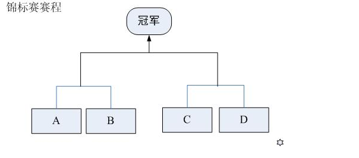

/*夺冠概率  
足球比赛具有一定程度的偶然性，弱队也有战胜强队的可能。  
假设有甲、乙、丙、丁四个球队。根据他们过去比赛的成绩，得出每个队与另一个队对阵时取胜的概率表:  
    甲   乙  丙  丁  
甲   -  0.1 0.3 0.5  
乙 0.9  -   0.7 0.4  
丙 0.7  0.3 -   0.2  
丁 0.5  0.6 0.8 -  
数据含义：甲对乙的取胜概率为0.1，丙对乙的胜率为0.3，…  
现在要举行一次锦标赛。双方抽签，分两个组比，获胜的两个队再争夺冠军。  
请你进行10万次模拟，计算出甲队夺冠的概率。

*/  

```c
double jisuan(int k)
{//根据比赛的顺序,算出每一场它胜利的概率
    if(k==0) return(0.1*(0.3*0.2+0.5*0.8));
    else if(k==1) return(0.3*(0.4*0.1+0.5*0.6));
    else if(k==2) return(0.5*(0.3*0.3+0.1*0.7));
}
#include"stdio.h"
#include"stdlib.h"
#include"time.h"
int main()
{long int a=100000;//随机实验的次数
    double rate=0;//定义
    srand((unsigned)time(NULL));
    for(long int i=0;i<a;i++)
    {int k=rand()%3;//k的值为0,1,2分别代表甲_乙、甲_丙、甲_丁,并以此决定比赛的顺序;
        rate=rate+jisuan(k)/1000.0;
    }
    rate=rate/100.0;
    printf("\nrate=%lf\n",rate);
    system("pause");
    return 1;
}
```


