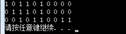

/*某电视台举办了低碳生活大奖赛。题目的计分规则相当奇怪：  
每位选手需要回答10个问题（其编号为1到10），越后面越有难度。答对的，当前分数翻倍；答错了则扣掉与题号相同的分数（选手必须回答问题，不回答按错误处理）。  
每位选手都有一个起步的分数为10分。  
某获胜选手最终得分刚好是100分，如果不让你看比赛过程，你能推断出他（她）哪个题目答对了，哪个题目答错了吗？  
如果把答对的记为1，答错的记为0，则10个题目的回答情况可以用仅含有1和0的串来表示。例如：0010110011 就是可能的情况。  
你的任务是算出所有可能情况。每个答案占一行。*/

```c
#include"stdio.h"
#include"stdlib.h"
int main()
{int a[10];
    for(int i=0;i<=1024;i++)
    {int score=10;
        for(int j=0;j<10;j++)
        {   a[j]=(i>>j)&1;

            if(a[j])//如果第j题答对了
            score=score*2;
            else score-=j+1;
        }//end for
        if(score==100)
        { for(int j=0;j<10;j++)
            printf("%d ",a[j]);
            printf("\n");
        }//end if
    }
    system("pause");}
```



法二,二叉树的方式:

/* Note:Your choice is C IDE */  

```c
#include "stdio.h"
int a[10];
int pailie(int i)
{int score,j;
    if(i==10)
    {score=10;
        for(j=0;j<10;j++)
        if(a[j])
        score*=2;
        else score-=j+1;
        if(score==100)
        {for(j=0;j<10;j++)
            printf("%d",a[j]);
            printf("\n");}
        return 1;
    }
    else
    {a[i]=0;
        pailie(i+1);
        a[i]=1;
        pailie(i+1);
    }
}
void main()
{
    pailie(0);

}
```
