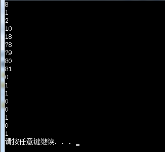

/*今盒子里有n个小球，A、B两人轮流从盒中取球，每个人都可以看到另一个人取了多少个，也可以看到盒中还剩下多少个，并且两人都很聪明，不会做出错误的判断。  
我们约定：  
每个人从盒子中取出的球的数目必须是：1，3，7或者8个。  
轮到某一方取球时不能弃权！  
A先取球，然后双方交替取球，直到取完。  
被迫拿到最后一个球的一方为负方（输方）  
请编程确定出在双方都不判断失误的情况下，对于特定的初始球数，A是否能赢？  
程序运行时，从标准输入获得数据，其格式如下：  
先是一个整数n(n<100)，表示接下来有n个整数。然后是n个整数，每个占一行（整数<10000），表示初始球数。  
程序则输出n行，表示A的输赢情况（输为0，赢为1）。  
例如，用户输入：  
４  
１  
２  
10  
18  
则程序应该输出：  
0  
1  
1  
0*/  

```c
#include"stdio.h"
#include"stdlib.h"
int main()
{int a[100],b[10001];
    int c[4]={1,3,7,8};//c存取球的方式
    int num;
    scanf("%d",&num);
    for(int i=0;i<num;i++)
    scanf("%d",&a[i]);
    for(int i=0;i<10001;i++) b[i]=0;
    c[0]=1;//第0个表示最后一个是由另一方取得,所以赢
    for(int i=0;i<10001;i++)//建立一张输赢表,下一次的输赢建立在上一次的赢上面
    { for(int j=0;j<4;j++)
        if(i>c[j]&&b[i-c[j]]==0)//b[i-c[j]]==0表示上一次是被a拿光了的,但是这次的球正好被乙拿光,所以乙在这种情况下就是输了的
        {b[i]=1;
            //break;
        }
    }
    for(int i=0;i<num;i++)
    printf("%d\n",b[a[i]]);
    system("pause");
    return 1;}
```


