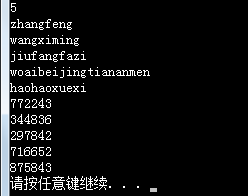

/*在对银行账户等重要权限设置密码的时候，我们常常遇到这样的烦恼：如果为了好记用生日吧，容易被破解，不安全；如果设置不好记的密码，又担心自己也会忘记；如果写在纸上，担心纸张被别人发现或弄丢了…  
这个程序的任务就是把一串拼音字母转换为6位数字（密码）。我们可以使用任何好记的拼音串(比如名字，王喜明，就写：wangximing)作为输入，程序输出6位数字。  
变换的过程如下：  
第一步. 把字符串6个一组折叠起来，比如wangximing则变为：  
wangxi  
ming  
第二步. 把所有垂直在同一个位置的字符的ascii码值相加，得出6个数字，如上面的例子，则得出：  
228 202 220 206 120 105  
第三步. 再把每个数字“缩位”处理：就是把每个位的数字相加，得出的数字如果不是一位数字，就再缩位，直到变成一位数字为止。例如: 228 => 2+2+8=12 => 1+2=3  
上面的数字缩位后变为：344836, 这就是程序最终的输出结果！  
要求程序从标准输入接收数据，在标准输出上输出结果。  
输入格式为：第一行是一个整数n（<100），表示下边有多少输入行，接下来是n行字符串，就是等待变换的字符串。  
输出格式为：n行变换后的6位密码。  
例如，输入：  
5  
zhangfeng  
wangximing  
jiujingfazi  
woaibeijingtiananmen  
haohaoxuexi  
则输出：  
772243  
344836  
297332  
716652  
875843  
注意：  
请仔细调试！您的程序只有能运行出正确结果的时候才有机会得分！  
在评卷时使用的输入数据与试卷中给出的实例数据可能是不同的。  
请把所有函数写在同一个文件中，调试好后，存入与【考生文件夹】下对应题号的“解答.txt”中即可。  
相关的工程文件不要拷入。  
源代码中不能能使用诸如绘图、Win32API、中断调用、硬件操作或与操作系统相关的API。  
允许使用STL类库，但不能使用MFC或ATL等非ANSI c++标准的类库。例如，不能使用CString类型（属于MFC类库）。*/  

```c
#include"stdio.h"
#include"stdlib.h"
#include"malloc.h"
int hebing(int a[][6],int i,int j,int b[][6],int num)
{//printf("i_%d,j_%d\n",i,j);
    for(int k=j;k<6;k++)
    {a[i-1][k]=0;
        //printf("i_%d k_%d_ %d\n",i,k,a[i-1][k]);
    }
    /* for(int c=0;c<i;c++)
    {for(int cc=0;cc<6;cc++)
        printf("%c",a[c][cc]);
        printf("\n"); }*/
    for(int t=0;t<6;t++)//每一列的数字相加
    {int  temp=0,kk=10;
        for(int k=0;k<i;k++)
        temp=temp+a[k][t];
        // printf("temp_%d\n",temp);
        while(kk>=10)//将数字进行合并
        {kk=0;
            while(temp>0)
            { kk=kk+temp%10;
                temp=temp/10;  }// end while
            temp=kk; }//end while
        b[num-1][t]=kk;
    }//end for
    return i;
}

int print(int b[][6],int k)
{ for(int j=k-1;j>=0;j--)
    {for(int i=0;i<6;i++)
        printf("%d",b[j][i]);
        printf("\n");
    }
    return 1;}

int main()
{int a[1000][6];
    int b[1000][6];
    int num,num1;
    char *p;
    scanf("%d",&num);
    num1=num;
    while(num>0)
    { p=(char*)malloc(sizeof(char)*1000);
        int temp=0,i,j;
        scanf("%s",p);//输入一串字母
        //printf("\n%s\n",p);
        for(i=0;p[temp]!='\0';i++)
        for( j=0;j<6;j++)//按六个一组分类
        { // printf("ij:i_%d  j_%d p:%c \n",i,j,p[temp]);
            if(p[temp]!='\0')
            a[i][j]=p[temp++];
            else { break;}
        }
        hebing(a,i,j,b,num);//这里num递减,所以输出的时候按照倒序输出
        num--;
    }//end while
```

```c
#include <cstring>
#define MAX 1005

long num[6];
char tmp[MAX];

int main()
{
    int t;
    scanf("%d", &t);
    while(t)
    {
        memset(num, 0, sizeof num);
        fgets(tmp, MAX, stdin);
        if(tmp[0] == '\n' || strlen(tmp) == 0) continue;

        for(int i = 0; tmp[i] != 0 && tmp[i] != '\n'; i++)
        {
            num[i%6] += tmp[i];
        }

        for(int j = 0; j < 6; j++)
        {
            int t = num[j] % 9;
            printf("%d", t ? t : 9);
        }
        putchar('\n');
        --t;
    }
    return 0;
}
```

print(b,num1);system("pause");}`



/*方法二 from line:

此题有一个技巧，原题的算法：228 => 2+2+8 => 12 => 1+2 => 3 其实只需要 228 => 228%9 => 3 即可，若余数为 0，则直接取 9 。

*/
