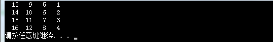

/*对一个方阵转置，就是把原来的行号变列号，原来的列号变行号  
例如，如下的方阵：           转置后变为：  

1  2  3  4                              1  5  9 13  
5  6  7  8                              2  6 10 14  
9  10 11 12                             3  7 11 15  
13 14 15 16                             4  8 12 16  
但，如果是对该方阵顺时针旋转（不是转置），却是如下结果：  
13  9  5  1  
14 10  6  2  
15 11  7  3  
16 12  8  4     下面的代码实现的功能就是要把一个方阵顺时针旋转。*/  

```c
#include"stdio.h"
#include"stdlib.h"
//旋转就相当于是先转置,然后将每一行的数进行倒序即ok
void rotate(int* x, int rank)
{ int* y = (int*)malloc(16*sizeof(int)); // 填空

    for(int i=0; i<rank * rank; i++)
    {
        y[(rank-i/rank-1)+rank*(i%rank) ] = x[i];// 填空,这里这样思考:要是y[]=x[i];第一步实现转置
        //转置就得确定行和列,原来的行->列,列->行 如果原来的地址是a*rank+b=i;
        //现在必须是b*rank+a=i;
        //然后每一行倒序,rank-a-1;这里a=i/rank;b=i%rank;
    }
    for(int i=0;i<rank*rank;i++)
    {
        x[i] = y[i];//改变x的值
    }
    free(y);
}

int main(int argc, char* argv[])
{ int x[4][4] = {{1,2,3,4},{5,6,7,8},{9,10,11,12},{13,14,15,16}};
    int rank = 4;
    rotate(&x[0][0], rank);
    for(int i=0; i<rank; i++)
    {
        for(int j=0; j<rank; j++)
        {
            printf("%4d", x[i][j]);
        }
        printf("\n");
    }
    system("pause");
    return 0; }
```


