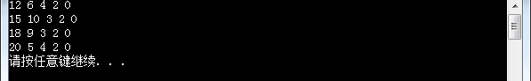

/*有一群海盗（不多于20人），在船上比拼酒量。过程如下：打开一瓶酒，所有在场的人平分喝下，有几个人倒下了。再打开一瓶酒平分，又有倒下的，再次重复...... 直到开了第4瓶酒，坐着的已经所剩无几，海盗船长也在其中。当第4瓶酒平分喝下后，大家都倒下了。

    等船长醒来，发现海盗船搁浅了。他在航海日志中写到：“......昨天，我正好喝了一瓶.......奉劝大家，开船不喝酒，喝酒别开船......”

    请你根据这些信息，推断开始有多少人，每一轮喝下来还剩多少人。

    如果有多个可能的答案，请列出所有答案，每个答案占一行。

    格式是：人数,人数,...

    例如,有一种可能是：20,5,4,2,0  
*/  

```c
//这个问题就是单位一的问题,每轮每人喝总数的1/n
#include"stdio.h"
#include"stdlib.h"
int main()
{int a[4];
    for(a[0]=0;a[0]<=20;a[0]++)
    for(a[1]=0;a[1]<a[0];a[1]++)
    for(a[2]=0;a[2]<a[1];a[2]++)
    for(a[3]=0;a[3]<a[2];a[3]++)
    {if(1.0/a[0]+1.0/a[1]+1.0/a[2]+1.0/a[3]==1.0)
        {for(int i=0;i<4;i++)
            printf("%d ",a[i]);
            printf("0\n");
    }}
    system("pause");}
```


