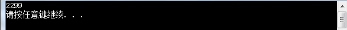

/*标题: 世纪末的星期  
曾有邪教称1999年12月31日是世界末日。当然该谣言已经不攻自破。  
还有人称今后的某个世纪末的12月31日，如果是星期一则会....  
有趣的是，任何一个世纪末的年份的12月31日都不可能是星期一!!   
于是，“谣言制造商”又修改为星期日......  
1999年的12月31日是星期五，请问：未来哪一个离我们最近的一个世纪末年（即xx99年）的12月31日正好是星期天（即星期日）？  
请回答该年份（只写这个4位整数，不要写12月31等多余信息）*/  

```c
#include"stdio.h"
#include"stdlib.h"
//判断是否是闰年
int runnian(int x)
{if((x%4==0&&x%100!=0)||x%400==0)
    return 1;
    return 0;}
//判断是否是世纪末年
int monian(int year)
{int i=2;
    while(i-->0)
    {if(year%10!=9) return 0;
        year=year/10;
    }
    return 1;
}
int main()
{//int a[12]={31,28,31,30,31,30,31,31,30,31,30,31};
    int alldays=0;//计算总的天数
    for(int year=2000;year<=9999;year++)
    {alldays=alldays+365;
        if(runnian(year)) alldays++;
        if(alldays%7==2&&monian(year))
        {printf("%d",year);
            break;}
        alldays=alldays%7;
    }
    printf("\n");
    system("pause");}
```


