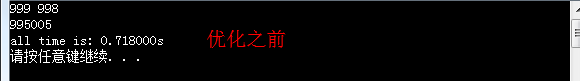
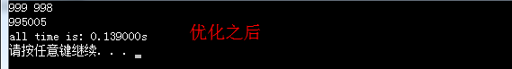

/*小明开了一家糖果店。他别出心裁：把水果糖包成4颗一包和7颗一包的两种。糖果不能拆包卖。  
    小朋友来买糖的时候，他就用这两种包装来组合。当然有些糖果数目是无法组合出来的，比如要买 10 颗糖。  
    你可以用计算机测试一下，在这种包装情况下，最大不能买到的数量是17。大于17的任何数字都可以用4和7组合出来。  
    本题的要求就是在已知两个包装的数量时，求最大不能组合出的数字。  
输入：  
两个正整数，表示每种包装中糖的颗数(都不多于1000)  
要求输出：  
一个正整数，表示最大不能买到的糖数  

例如：  
用户输入：  
4 7  
程序应该输出：  
17  

再例如：  
用户输入：  
3 5  
程序应该输出：  

7*/

方法一:

```c
#include"stdio.h"
#include"stdlib.h"
#include"time.h"
#define max 100000000
int main()
{int m,n;
    long int start,finish;
    scanf("%d %d",&m,&n);
    start=clock();
    long int *p;
    p=(long *)malloc(sizeof(long)*max);//开辟空间,建立一张0,1表
    p[0]=1;//初始化
    for(long int i=1;i<max;i++)
    {p[i]=0;//初始化
        if(i>=m&&p[i-m]) p[i]=1;
        else
        if(i>=n&&p[i-n]) p[i]=1;
    }
    long int kk=0;
    for(long int i=0;i<max;i++)
    {if(i>kk&&!p[i])
        kk=i;
    }
    printf("%ld",kk);
    finish=clock();
    printf("\nall time is: %lfs",(finish-start)/1000.0);
    printf("\n");
    system("pause");
}
```

//少量优化,当这个数字更加的大的时候如果出现了n个连续的p[i]==1的情况,那么后面的所有数字都不用再判断,如此优化,n<m

  

方法二:

```c
#include"stdio.h"
#include"stdlib.h"
#include"time.h"
#define max 100000000
int main()
{int m,n,temp;
    long int start,finish;
    scanf("%d %d",&m,&n);
    start=clock();
    long int *p;
    p=(long *)malloc(sizeof(long)*max);//开辟空间,建立一张0,1表
    p[0]=1;//初始化
    if(m<n)
    {temp=m; m=n ;n=temp;}//保证n<m
    temp=0;//初始化
    for(long int i=1;i<max;i++)
    {p[i]=0;//初始化
        if(i>=m&&p[i-m]) p[i]=1;
        else
        if(i>=n&&p[i-n]) p[i]=1;
        if(p[i]) temp++; else temp=0;
        if(temp==n) {printf("%ld",i-n); break; }
    }
    /*long int kk=0;
    for(long int i=0;i<max;i++)
    {if(i>kk&&!p[i])
        kk=i;
    }
    printf("%ld",kk);*/
    finish=clock();
    printf("\nall time is: %lfs",(finish-start)/1000.0);
    printf("\n");
    system("pause");
}
```

  
