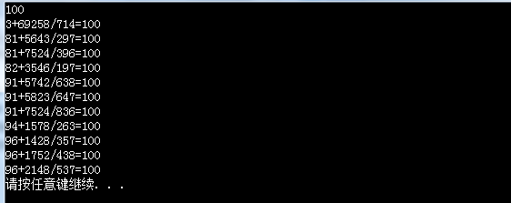
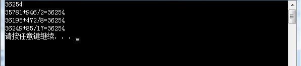

/*标题：带分数  
100 可以表示为带分数的形式：100 = 3 + 69258 / 714  
还可以表示为：100 = 82 + 3546 / 197  
注意特征：带分数中，数字1~9分别出现且只出现一次（不包含0）。  
类似这样的带分数，100 有 11 种表示法。  
题目要求：  
从标准输入读入一个正整数N (N<1000*1000)  
程序输出该数字用数码1~9不重复不遗漏地组成带分数表示的全部种数。  
注意：不要求输出每个表示，只统计有多少表示法！  
例如：  
用户输入：  
100  
程序输出：  
11  
再例如：  
用户输入：  
105  
程序输出：  
6  
资源约定：  
峰值内存消耗（含虚拟机） < 64M  
CPU消耗  < 3000ms*/

以下代码只算出一些具体结果,不进行统计,相信以大家的能力统计没问题的:  
比较传统的方法(速度比较慢):

```c
#include"stdio.h"
#include"stdlib.h"
#include"math.h"
long int a[10];
int xiangtong()
{for(int i=0;i<10&&a[i]!=-1;i++)
    for(int j=0;j<10;j++)
    if(i!=j&&a[i]==a[j]&&a[i]!=-1)
    return 1;
    return 0;}
int print()
{for(int i=0;i<10;i++)
    printf("%d ",a[i]);
    printf("\n");
    return 1; }
int youling(int i)
{for(int j=0;j<=i;j++)
    if(a[j]==0)
    return 1;
    return 0;
}
int main()
{long int k,kk,N,x;
    for(int i=0;i<10;i++)
    a[i]=-1;
    scanf("%ld",&N);
    for(int x=1;x<N;x++)
    {for(int i=0;i<10;i++)
        a[i]=-1;
        long int temp=x;
        int i=0;
        while(temp>0)
        {a[i++]=temp%10;
            temp=temp/10;
        }
        int temp0=i;
        if(xiangtong()||youling(i)) continue;
        long int y=N-x;
        for(kk=1;kk<98766;kk++)
        {i=temp0;
            temp=kk;
            for(int w=i;w<10;w++)
            a[w]=-1;
            while(temp>0)
            {a[i++]=temp%10;
                temp=temp/10;
            }//end while
            //if(kk==98765)
            //print();
            if(i>9) break;
            //printf("i=%d:\n",i);
            if(xiangtong()||youling(i)) continue;
            k=y*kk;
            temp=k;
            //被除数的计算
            while(temp>0)
            {a[i++]=temp%10;
                temp=temp/10;
            }//end while
            if(i>9) continue;
            //printf("i=%d\n",i);
            //if(i==10) printf("%ld+%ld/%ld=%ld\n",x,k,kk,N);
            if(!xiangtong()&&!youling(10)&&i==9)
            printf("%ld+%ld/%ld=%ld\n",x,k,kk,N);
        }//end for kk
    }//end x
    system("pause");}
```



优化较大的算法,因为先排序,在判断,所以总的时间都差不多,与输入N的关系较小(速度较快,3s以内):

```c
#include"stdio.h"
#include"stdlib.h"
long int a[9];//存储每个数字
long int num=0;//计数总的方式
int xiangtong(int star,int nowdeep)
{for(int i=star;i<=nowdeep;i++)
    for(int j=star;j<=nowdeep;j++)
    if(i!=j&&a[i]==a[j]&&a[i]!=-1)
    return 1;
    return 0;
}
//x,y是加数
int pailie(long int N)
{ long int x,y,temp1,temp2;
    for(int i=0;i<=7;i++)//0到7层依次排序
    {int k=0;
        x=0;
        for(k=0;k<=i;k++)
        x=x*10+a[k];
        if(x>=N) break;
        y=N-x;
        //printf("k=%d i-k=%d 8-i+1=%d\n",k,i-k+2,8-i+1);
        for(int cur=i+1;cur<=7;cur++)
        { if(cur-i<8-cur) continue;//如果temp1的位数小于temp2的位数,跳过循环
            //printf("%d %d\n",cur-i,8-cur);验证位数比较是否正确
            temp1=temp2=0;
            for(int j=k;j<=cur;j++)
            temp1=temp1*10+a[j];
            for(int j=cur+1;j<=8;j++)
            temp2=temp2*10+a[j];
            //printf("%ld+%ld/%ld%=%ld\n",x,temp1,temp2,x+y);
            if(temp1/temp2>y) break;
            if(temp1%temp2==0&&(temp1/temp2==y)&&!xiangtong(0,8))
            printf("%ld+%ld/%ld%=%ld\n",x,temp1,temp2,x+y);
            //print();
        }//end for cur
    }//end for i
    return 1;}
//N是输入的整数,i是当前存在的一个加数,nowdeepshi现在的深度,deep是总的调用应有的深度
//这里采用先排列好,然后再用的方法
int daifenshu(long int N,int nowdeep,int deep)
{ if(xiangtong(0,nowdeep-1))
    { //print();
        return 1;}
    if(nowdeep==deep+1)
    { if(!xiangtong(0,deep))
        pailie(N);
        //print();
        return 1;
    }
    for(int j=1;j<=9;j++)
    {a[nowdeep]=j;
        if(a[0]>=N) break;
        daifenshu(N,nowdeep+1,deep);
    }
    return 1;
}
int main()
{ long int N;
    scanf("%ld",&N);
    daifenshu(N,0,8);
    system("pause");}
```



方法三:(速度最慢,因为调用的排序次数很多,N越大速度越慢):

```c
#include"stdio.h"
#include"stdlib.h"
long int a[9];//存储每个数字
long int num=0;//计数总的方式
int xiangtong(int star,int nowdeep)
{for(int i=star;i<=nowdeep;i++)
    for(int j=star;j<=nowdeep;j++)
    if(i!=j&&a[i]==a[j]&&a[i]!=-1)
    return 1;
    return 0;
}
//y是另外一个加数的值
int pailie(int k,long int y,long int x)
{ for(int i=0;i<k;i++)
    {
        if(i<(k-i-1)) continue;
        long int temp1=0,temp2=0;
        for(int j=0;j<=i;j++)
        temp1=temp1*10+a[j];
        for(int j=i+1;j<=k;j++)
        temp2=temp2*10+a[j];
        //printf("%ld+%ld/%ld%=%ld\n",x,temp1,temp2,x+y);
        if(temp1/temp2>y) break;
        if(temp1%temp2==0&&(temp1/temp2==y)&&!xiangtong(0,8))
        printf("%ld+%ld/%ld%=%ld\n",x,temp1,temp2,x+y);
        //print();
    }//end for i
    return 1;}
//N是输入的整数,i是当前存在的一个加数,nowdeepshi现在的深度,deep是总的调用应有的深度
int daifenshu(long int N,long int i,int nowdeep,int deep)
{if(xiangtong(0,nowdeep-1)) return 1;
    if(nowdeep==deep+1)
    {if(!xiangtong(0,deep))
        pailie(deep,N-i,i);
        //print();
        return 1;
    }
    for(int j=1;j<=9;j++)
    {a[nowdeep]=j;
        daifenshu(N,i,nowdeep+1,deep);
    }
    return 1;
}
int main()
{ long int N;
    scanf("%ld",&N);
    for(long int i=1;i<N-1;i++)
    { for(int j=0;j<9;j++)
        a[j]=-1;//初始化
        int temp=8;//temp用来保存位数
        long int k=i;//将每一位存入a中
        while(k>0)
        {a[temp--]=k%10;
            k=k/10;
        }
        //chufa(temp,N-i,N);
        if(xiangtong(i+1,8))
        continue;
        int key=0;
        for(int k=temp+1;k<9;k++)
        if(a[k]==0){ key=1; break;}
        if(key) continue;
        daifenshu(N,i,0,temp);
    }//end for i;
    system("pause");}
```
