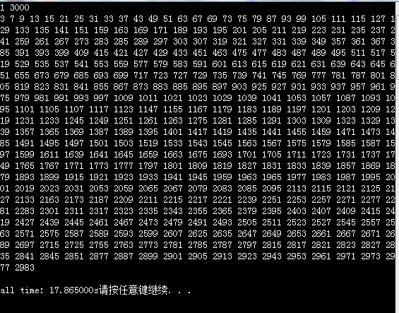
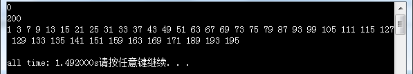

/*标题：幸运数幸运数是波兰数学家乌拉姆命名的。它采用与生成素数类似的“筛法”生成。首先从1开始写出自然数1,2,3,4,5,6,....1 就是第一个幸运数。我们从2这个数开始。把所有序号能被2整除的项删除，变为：1 _ 3 _ 5 _ 7 _ 9 ....把它们缩紧，重新记序，为：1 3 5 7 9 .... 。这时，3为第2个幸运数，然后把所有能被3整除的序号位置的数删去。注意，是序号位置，不是那个数本身能否被3整除!! 删除的应该是5，11, 17, ...此时7为第3个幸运数，然后再删去序号位置能被7整除的(19,39,...) 最后剩下的序列类似： 1, 3, 7, 9, 13, 15, 21, 25, 31, 33, 37, 43, 49, 51, 63, 67, 69, 73, 75, 79, ...本题要求：输入两个正整数m n, 用空格分开 (m < n < 1000*1000)程序输出 位于m和n之间的幸运数的个数（不包含m和n）。例如：用户输入：1 20程序输出：5例如：用户输入：30 69程序输出：8

资源约定：峰值内存消耗（含虚拟机） < 64MCPU消耗  < 2000ms */

法一:将统计总数的方式由加法变为减法,速度快了很多,在总数为1000000(一百万)的情况下,耗时17s左右:

```c
#include"stdio.h"
#include"stdlib.h"
#include"time.h"
#define max 1000000
int main()
{//long long int a[max];//建立一张幸运数的表,因为数组过大,采用指针方式开辟空间
    long int i,j=0;
    long int temp=max,kk=1;
    long int temp1=0;
    long int *a;
    long int m,n;
    long start,finish;
    a=(long int *)malloc(sizeof(long int)*max);
    for(i=0;i<max;i++)
    a[i]=i+1;//赋予初值
    scanf("%ld %ld",&m,&n);
    start=clock();//开始时间

    for(i=0;i<temp;)//a[k]为每一次保存的模
    { if(a[i]>kk) { kk=a[i];}
        else
        {i++;
            continue;}
        //根据每一次保存的模将上一次中"相关"的数字给排除掉
        temp1=0;
        for(j=kk;j<temp;j+=kk)
        {a[j-1]=0;
            temp1++;;//每将一个数字变为0后,temp++
        }
        long int temp2=0;
        for(j=0;j<temp;j++)
        {if(a[j]) a[temp2++]=a[j];
        }//重新排列,将有零的"去掉"
        temp-=temp1;//剩下数字的总数减少
    }//end for i

    for(i=0;i<temp;i++)
    if(a[i]&&a[i]>m&&a[i]<n)
    printf("%ld ",a[i]);
    printf("\n");
    finish=clock();//结束时间

    printf("\nall time: %lfs",(finish-start)/1000.0);
    system("pause"); }
```

  

法二,改变每次剔除不合格数字的上限和下限,加快速度:

```c
#include"stdio.h"
#include"stdlib.h"
#include"time.h"
#define max 1000000
int main()
{//long long int a[max];//建立一张幸运数的表,因为数组过大,采用指针方式开辟空间
    long int i,j=0;
    long int temp=max,kk=1;
    long int temp1=0,temp2=1;
    long int *a;
    long int m,n;
    long start,finish;
    a=(long int *)malloc(sizeof(long int)*max);
    for(i=0;i<max;i++)
    a[i]=i+1;//赋予初值
    scanf("%ld %ld",&m,&n);
    start=clock();//开始时间
    for(i=1;i<temp;i++)//用temp表示数组个数上限,用temp2表示当前模序号,kk保存当前模的值
    { kk=a[temp2];
        if(kk>temp) break;
        if(kk==temp){temp--; break; }
        temp1=kk-1;
        for(j=kk;j<=temp;j++)//从模的序列号出发,因为前面的值小于模所以值不会变
        { if(j%kk!=0) a[temp1++]=a[j-1];}
        temp=temp1;
        if(a[temp2]<=kk)
        temp2++;//选定每一次的额模
    }//end for i
    for(i=0;i<temp;i++)
    if(a[i]&&a[i]>m&&a[i]<n)
    printf("%ld ",a[i]);
    printf("\n");
    finish=clock();//结束时间
    printf("\nall time: %lfs",(finish-start)/1000.0);
    system("pause"); }
```


