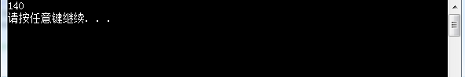

/*标题: 振兴中华  
小明参加了学校的趣味运动会，其中的一个项目是：跳格子。  
地上画着一些格子，每个格子里写一个字，如下所示：（也可参见p1.jpg）  
从我做起振  
我做起振兴  
做起振兴中  
起振兴中华  
比赛时，先站在左上角的写着“从”字的格子里，可以横向或纵向跳到相邻的格子里，但不能跳到对角的格子或其它位置。一直要跳到“华”字结束。  
要求跳过的路线刚好构成“从我做起振兴中华”这句话。  
请你帮助小明算一算他一共有多少种可能的跳跃路线呢？  
答案是一个整数，请通过浏览器直接提交该数字。  
注意：不要提交解答过程，或其它辅助说明类的内容。  
*/

```c
//这个题的方法因该比较多,但是比较相似的使用递归,这里用这种优化很少的方法:
#include"stdio.h"
#include"stdlib.h"
int num0=0;//计算总的方式
//step为已经跳过的
int jump(int i,int rol,int j,int col,int a[4][5],int step,int z[8])
{//每一次的调用有横纵两种方式
    if(step==8)
    {int key=1;
        for(int i=0;i<8;i++)  if(i!=z[i]) key=0;
        if(key)
        { num0++;
            //for(int i=0;i<8;i++)
            //printf("%d ",z[i]);
            //   printf("\n");
        }
    }//end if(s)
    if(step>=8) return 1;
    if(i>0)
    {z[step]=a[i][j]; jump(i-1,rol,j,col,a,step+1,z);}
    if(j>0)
    {z[step]=a[i][j]; jump(i,rol,j-1,col,a,step+1,z);}
    if(i<rol)
    {z[step]=a[i][j]; jump(i+1,rol,j,col,a,step+1,z);}
    if(j<col)
    {z[step]=a[i][j]; jump(i,rol,j+1,col,a,step+1,z);}
    return 1;}
int main()
{int a[4][5];
    int z[8];//用来保存走过的路径
    //开始初始化
    int k=0;
    for(int i=0;i<4;i++)
    { for(int j=0;j<5;j++)
        {a[i][j]=k+j;
        }//end for j
        k++;}//end for i
    for(int i=0;i<8;i++)
    z[i]=-1;
    jump(0,4,0,5,a,0,z);
    printf("%d",num0);
    printf("\n");
    system("pause");}
```


