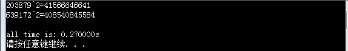

/*排它平方数:  
小明正看着 203879 这个数字发呆。  
    原来，203879 * 203879 = 41566646641  
    这有什么神奇呢？仔细观察，203879 是个6位数，并且它的每个数位上的数字都是不同的，并且它平方后的所有数位上都不出现组成它自身的数字。  
    具有这样特点的6位数还有一个，请你找出它！  
    再归纳一下筛选要求：  
    1\. 6位正整数  
    2\. 每个数位上的数字不同  
    3\. 其平方数的每个数位不含原数字的任何组成数位  
答案是一个6位的正整数。  
请通过浏览器提交答案。  
注意：只提交另一6位数，题中已经给出的这个不要提交。*/  

```c
#include"stdio.h"
#include"stdlib.h"
#include"time.h"
int xiangtong(int a[],int k)
{for(int c1=0;c1<k;c1++)
    for(int c2=0;c2<k;c2++)
    if(c1!=c2&&a[c1]==a[c2])
    return 1;//表示相同
    return 0;//表示不同
}
int main()
{long long kk;//保存平方后的结果
    long int start,finish;
    start=clock();
    for(long long int i=102345;i<987654;i++)//这里不能用long型,会出错
    {int a[6],b[12],k=0,k1=0;//用来保存i中的每一位
        long long temp=i;
        while(temp>0)
        {a[k++]=temp%10;
            temp=temp/10;
        }//a的地位保存数的低位,a的高位保存数的高位
        if(!xiangtong(a,k))
        { kk=i*i;
            while(kk>0)
            {b[k1++]=kk%10;
                kk=kk/10;}
            int key=0;//相同为1,不同为0
            for(int c1=0;c1<6;c1++)
            for(int c2=0;c2<k1;c2++)
            if(a[c1]==b[c2]) {key=1; break; }
            if(!key)
            {printf("%lld^2=%lld\n",i,i*i); }
        }//end if
    }//end for
    finish=clock();
    printf("\nall time is: %lfs",(finish-start)/1000.0);
    printf("\n");
    system("pause");
}
```

  
