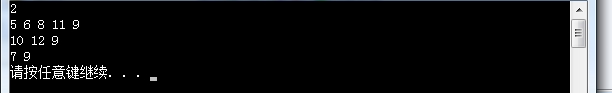
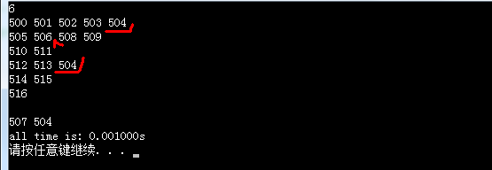

/*标题：错误票据  
某涉密单位下发了某种票据，并要在年终全部收回。  
每张票据有唯一的ID号。全年所有票据的ID号是连续的，但ID的开始数码是随机选定的。  
因为工作人员疏忽，在录入ID号的时候发生了一处错误，造成了某个ID断号，另外一个ID重号。  
你的任务是通过编程，找出断号的ID和重号的ID。  
假设断号不可能发生在最大和最小号。  
要求程序首先输入一个整数N(N<100)表示后面数据行数。  
接着读入N行数据。  
每行数据长度不等，是用空格分开的若干个（不大于100个）正整数（不大于100000）  
每个整数代表一个ID号。  
要求程序输出1行，含两个整数m n，用空格分隔。  
其中，m表示断号ID，n表示重号ID  
例如：  
用户输入：  
2  
5 6 8 11 9   
10 12 9  
则程序输出：  
7 9  
再例如：  
用户输入：  
6  
164 178 108 109 180 155 141 159 104 182 179 118 137 184 115 124 125 129 168 196  
172 189 127 107 112 192 103 131 133 169 158   
128 102 110 148 139 157 140 195 197  
185 152 135 106 123 173 122 136 174 191 145 116 151 143 175 120 161 134 162 190  
149 138 142 146 199 126 165 156 153 193 144 166 170 121 171 132 101 194 187 188  
113 130 176 154 177 120 117 150 114 183 186 181 100 163 160 167 147 198 111 119  
则程序输出：  
105 120  
资源约定：  
峰值内存消耗（含虚拟机） < 64M  
CPU消耗  < 2000ms  
*/

```c
#include"stdio.h"
#include"stdlib.h"
int main()
{long int max=0,min=9999;
    int num;
    int k=0;
    long int a[10000];
    char b[1000];
    for(int i=0;i<10000;i++)
    a[i]=0;
    scanf("%d",&num);
    //scanf("%s",b);//用scanf的时候遇到空格会自动停止
    gets(b);//第一个用来吸收回车键
    long int temp=0;
    for(int i=0;i<num;i++)
    {int j=0;
        for(int t=0;t<1000;t++)
        b[t]='\0';
        gets(b);
        do
        { if(b[j]!=' ')
            {
                temp=b[j]-48;
                a[k]=a[k]*10+temp;
                //j++;
            }
            if(b[j]==' ')
            { k++;
            }
        }while(b[++j]!='\0');
        k++;
        //end while
    }//end for i

    for(int i=0;a[i]!=0;i++)
    {if(a[i]>max) max=a[i];
        if(a[i]<min) min=a[i];}
    //printf("min=%ld max=%ld :\n",min,max);

    for(int j=min;j<=max;j++)
    {int key=0;
        for(int i=0;a[i]!=0;i++)
        if(a[i]==j) {key=1; break;}
        if(!key)
        {printf("%ld ",j); break;}
    }
    for(int i=0;a[i]!=0;i++)
    {int key=0;
        for(int j=0;a[j]!=0;j++)
        if(i!=j&&a[i]==a[j])
        {key=1; break;}
        if(key)
        {printf("%ld",a[i]);
            break;}
    }//end for i
    printf("\n");
    system("pause");}
```

  

笔者对上述方法不是很满意,自已又查找各种资料,想出一种:

```c
#include"stdio.h"
#include"stdlib.h"
#include"time.h"
#define max 100001
int main()
{long int temp,m,n,max1=0,min1=max;
    char c='\0';
    long int start,finish;
    scanf("%ld",&n);
    long int *p=(long int *)malloc(sizeof(long)*max);
    for(temp=0;temp<max;temp++)
    p[temp]=0;//初始化
    for(m=0;m<n;m++)
    {while(scanf("%ld%c",&temp,&c)==2)//如果输入参数为2
        {//这里必须记住的是,c是字符,其结束的enter字符是'\n',若是字符串,则是以'\0'结尾
            if(temp>max1) max1=temp;
            if(temp<min1) min1=temp;
            p[temp]++;
            if(c=='\n') break;
        }//end while
    }//end for
    start=clock();
    for(m=min1;m<=max1;m++)
    {if(p[m]==0) n=m;
        if(p[m]==2) temp=m;}
    printf("\n%ld %ld",n,temp);
    finish=clock();
    printf("\nall time is: %lfs",(finish-start)/1000.0);
    printf("\n");
    system("pause");
}
```

  
