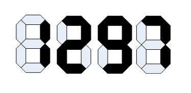
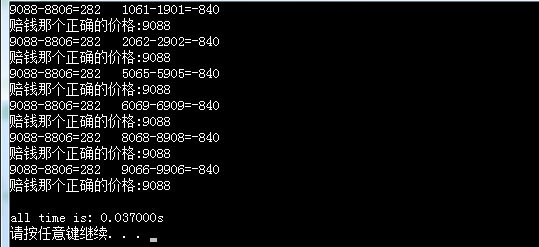

/*小李的店里专卖其它店中下架的样品电视机，可称为：样品电视专卖店。  
    其标价都是4位数字（即千元不等）。  
    小李为了标价清晰、方便，使用了预制的类似数码管的标价签，只要用颜色笔涂数字就可以了（参见p1.jpg）。  
    这种价牌有个特点，对一些数字，倒过来看也是合理的数字。如：1 2 5 6 8 9 0 都可以。  
这样一来，如果牌子挂倒了，有可能完全变成了另一个价格，比如：1958 倒着挂就是：8561，差了几千元啊!!   
    当然，多数情况不能倒读，比如，1110 就不能倒过来，因为0不能作为开始数字。  
    有一天，悲剧终于发生了。某个店员不小心把店里的某两个价格牌给挂倒了。并且这两个价格牌的电视机都卖出去了!  
    庆幸的是价格出入不大，其中一个价牌赔了2百多，另一个价牌却赚了8百多，综合起来，反而多赚了558元。  
    请根据这些信息计算：赔钱的那个价牌正确的价格应该是多少？  
答案是一个4位的整数，请通过浏览器直接提交该数字。  

注意：不要提交解答过程，或其它辅助说明类的内容。

*/

```c
#include"stdio.h"
#include"stdlib.h"
#include"time.h"
int each(int a[],int k)//求k的每一位,存到a中
{for(int i=0;k>0;k=k/10)
a[i++]=k%10;
return 1;
}//a[0]是最低位
int all(int a[])//将a中存的数倒叙合并
{int k=0;
	for(int i=0;i<4;i++)
	{int temp=a[i];
		if(temp==6) temp=9;
	else if(temp==9) temp=6;//6,9的兑换
		k=k*10+temp;}//a[0]变成了最高位
return k;}
int can(int a[])
{int x[3]={3,4,7};
for(int i=0;i<3;i++)
for(int j=0;j<4;j++)
if(a[j]==x[i]) return 0;//表示不合理
return 1;
}//判断这个数字是否合理,既是否只包含1 2 5 6 8 9 0 
int main()
{
long int start,finish;
start=clock();
int d1,d2;//颠倒后的两个价格
int a[4],b[4];//保存价格每一个位数
int c1,c2;//颠倒前的两个价格
for(d1=1000;d1<10000;d1++)
{each(a,d1);
if(!can(a)) continue;
c1=all(a);
if(c1<1000||c1-d1<=200||c1-d1>=300) continue;//赔了两百多
for(d2=1000;d2<10000;d2++)
{each(b,d2); if(!can(b)) continue;
c2=all(b); 
if(c2<1000||d2-c2<=800||d2-c2>=900) continue;//赚了800多
if(d1-c1+d2-c2==558)
printf("%d-%d=%d   %d-%d=%d\n赔钱那个正确的价格:%d\n",c1,d1,c1-d1,c2,d2,c2-d2,c1);
}//end for d2
}//end for d1
finish=clock();
printf("\nall time is: %lfs",(finish-start)/1000.0);
printf("\n");
system("pause");
}
```

  
