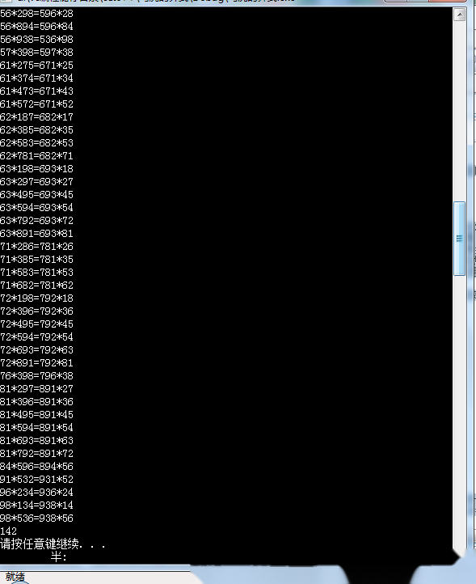

/*  
标题: 马虎的算式  
小明是个急性子，上小学的时候经常把老师写在黑板上的题目抄错了。  
有一次，老师出的题目是：36 x 495 = ?  
他却给抄成了：396 x 45 = ?  
但结果却很戏剧性，他的答案竟然是对的！！  
因为 36 * 495 = 396 * 45 = 17820  
类似这样的巧合情况可能还有很多，比如：27 * 594 = 297 * 54  
假设 a b c d e 代表1~9不同的5个数字（注意是各不相同的数字，且不含0）  
能满足形如： ab * cde = adb * ce 这样的算式一共有多少种呢？  
请你利用计算机的优势寻找所有的可能，并回答不同算式的种类数。  
满足乘法交换律的算式计为不同的种类，所以答案肯定是个偶数。  
答案直接通过浏览器提交。  
注意：只提交一个表示最终统计种类数的数字，不要提交解答过程或其它多余的内容。*/

```c
#include"stdio.h"
#include"stdlib.h"
int xiangtong(int a,int b,int c,int d,int e)
{int x[5]={a,b,c,d,e};
    for(int i=0;i<5;i++)
    for(int j=0;j<5;j++)
    if(i!=j&&x[i]==x[j]) return 1;
    return 0;}
int main()
{int a,b,c,d,e;
    int num=0;
    for(a=1;a<10;a++)
    {for(b=1;b<10;b++)
        for(c=1;c<10;c++)
        for(d=1;d<10;d++)
        for(e=1;e<10;e++)
        {if((a*10+b)*(c*100+d*10+e)==(a*100+d*10+b)*(c*10+e)&&!xiangtong(a,b,c,d,e))
            {printf("%ld*%ld=%ld*%ld\n",a*10+b,c*100+d*10+e,a*100+d*10+b,c*10+e);
                num++;
        }}
    }//end a
    printf("%d\n",num);
    system("pause");}
```


