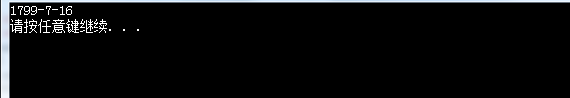

/*高斯日记  
大数学家高斯有个好习惯：无论如何都要记日记。  
他的日记有个与众不同的地方，他从不注明年月日，而是用一个整数代替，比如：4210  
后来人们知道，那个整数就是日期，它表示那一天是高斯出生后的第几天。这或许也是个好习惯，它时时刻刻提醒着主人：  
日子又过去一天，还有多少时光可以用于浪费呢？  
高斯出生于：1777年4月30日。  
在高斯发现的一个重要定理的日记上标注着：5343，因此可算出那天是：1791年12月15日。  
高斯获得博士学位的那天日记上标着：8113     
请你算出高斯获得博士学位的年月日。  
提交答案的格式是：yyyy-mm-dd, 例如：1980-03-21  
请严格按照格式，通过浏览器提交答案。  
注意：只提交这个日期，不要写其它附加内容，比如：说明性的文字。*/  

```c
#include "stdlib.h"
#include "stdio.h"
int max=8113-1;
int all=0;
int runnian(int year)
{if((year%4==0&&year%100!=0)||(year%400==0))
	return 1;
else return 0;
}//判断是否是闰年
int jisuan(int year,int month,int day,int a[])
{   if(runnian(year)){
	 	a[1]=29;
	}else{
	    a[1]=28;
	}	
	for(int m=month;m<12&&all<max;m++)
	{	
		for(int d=day;d<=a[m]&&all<max;d++)
		{	all++;
			if(all==max) 
			{
				printf("%d-%d-%d",year,m+1,d); return 1;
		    }
		}
	}//end for
}
int main()
{int a[12]={31,28,31,30,31,30,31,31,30,31,30,31};
	jisuan(1777,4,1,a);
	for(int i=1778;all<max;i++)
	{	
		jisuan(i,0,1,a);
	}
	printf("\n");
	system("pause");
}
```

  

20151207,上面用的是循环,并没有刻意针对年份和月份等优化,下面给出一个递归的优化后的代码,由于时间有限,水平有限,就这样了.....:

```c
#include "stdio.h"
#include "stdlib.h"
int max=8113-1;
int all=0;
int a[12]={31,28,31,30,31,30,31,31,30,31,30,31};
int runnian(int year)
{  if((year%4==0&&year%100!=0)||(year%400==0))
    return 1;
    else return 0;
}//判断是否是闰年

int jisuan(int year,int month,int day)
{  int y=year,m=month,d=day;
    int run=runnian(y);
    if(run) {
        a[1]=29;
    }else{
        a[1]=28;
    }
    if(all==max) {printf("%d-%d-%d",year,m+1,d); return 1; }
    if(m==11&&day==a[m]){
        y++;//如果是12月
        m=0;
        d=1;
        all++;
        return jisuan(y,m,d);
    }
    if(day==a[m]){
        m++;
        d=1;
        all++;
        return jisuan(y,m,d);
    }

    if(run&&(all+366<=max))
    {
        y++;
        all+=366;
        return jisuan(y,m,d);
    }else if(!run&&(all+365<=max)){
        y++;
        all+=365;
        return jisuan(y,m,d);
    }

    if(m<=11&&all+a[m]<=max){
        if(m!=11)
        m++;
        all+=a[m];
        return jisuan(y,m,d);
    }
    all++;
    return jisuan(y,m,d+1);
}
int main()
{
    jisuan(1777,3,30);
    printf("\n");
    system("pause");
    return 1;
}
```
