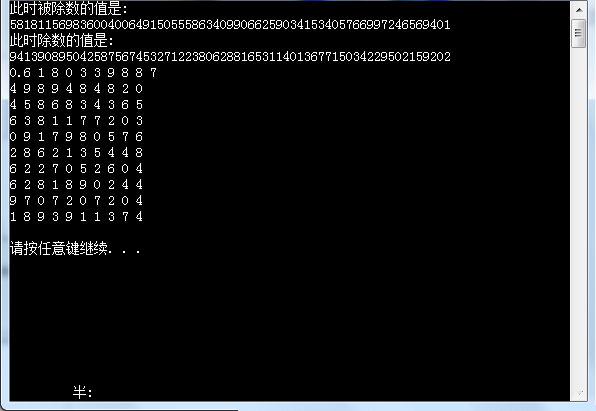
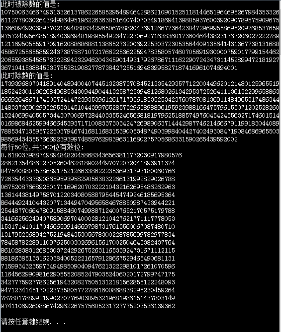

/*标题: 黄金连分数  
黄金分割数0.61803... 是个无理数，这个常数十分重要，在许多工程问题中会出现。有时需要把这个数字求得很精确。  
对于某些精密工程，常数的精度很重要。也许你听说过哈勃太空望远镜，它首次升空后就发现了一处人工加工错误，对那样一个庞然大物，其实只是镜面加工时有比头发丝还细许多倍的一处错误而已，却使它成了“近视眼”!!  
言归正传，我们如何求得黄金分割数的尽可能精确的值呢？有许多方法。  
比较简单的一种是用连分数：  
黄金数 = ---------------------  
                        1  
             1 + \-----------------  
                          1  
                 1 + \-------------  
                            1  
                     1 + \---------  
                          1 + ...  
这个连分数计算的“层数”越多，它的值越接近黄金分割数。  
请你利用这一特性，求出黄金分割数的足够精确值，要求四舍五入到小数点后100位。  
小数点后3位的值为：0.618  
小数点后4位的值为：0.6180  
小数点后5位的值为：0.61803  
小数点后7位的值为：0.6180340  
（注意尾部的0，不能忽略）  
你的任务是：写出精确到小数点后100位精度的黄金分割值。  
注意：尾数的四舍五入！ 尾数是0也要保留！  
显然答案是一个小数，其小数点后有100位数字，请通过浏览器直接提交该数字。  
注意：不要提交解答过程，或其它辅助说明类的内容。  
*/  

```c
#include"stdio.h"
#include"stdlib.h"
int a[101];//a保存小数结果
int c[9000];//用来保存被除数的每一位
int point;//记录小数点的位置

int print(int x[])
{int j;
    for(int i=999;i>=0;i--)
    if(x[i]!=0) { j=i; break; }
    for(int i=j;i>=0;i--)
    printf("%d",x[i]);
    printf("\n");
    return 1;
} //输出一个数组中保存的值

int add(int x[],int y[])
{ int length_x,length_y;
    int jinwei=0;//记录进位
    int temp_y[1000];
    for(int i=0;i<1000;i++)
    { if(x[i]==0) length_x=i;
        if(y[i]==0) length_y=i;
        temp_y[i]=y[i];}//计算两个数字的长度
    //x[0]保存最低位
    for(int i=0;i<1000;i++)
    { y[i]=(x[i]+y[i])+jinwei;
        jinwei=y[i]/10;
        y[i]=y[i]%10;
        //if(i<20)
        //printf("i=%d x_%d ,y_%d\n",i,x[i],y[i]);
    }
    for(int i=0;i<1000;i++)
    x[i]=temp_y[i];
    /*
    printf("x:  ");
    print(x);
    printf("y:  ");
    print(y);
    */
    return 1;
}
int subcmp(int x[],int y[])
{//x[0]是最低位
    int j_x,j_y,j,i;
    for(i=999;i>=0;i--)
    if(x[i]!=0) { j_x=i; break; }//确定最高位
    for(i=999;i>=0;i--)
    if(y[i]!=0) { j_y=i; break; }//确定最高位
    if(j_x>j_y) return 1;//x中的值大于y中的
    if(j_x<j_y) return -1;//x中的值小于于y中的
    if(j_x==j_y)//当两个数位数相同的时候
    {for(i=j_x;i>=0;i--)
        {if(x[i]>y[i]) return 1;
            if(x[i]<y[i]) return -1;}
        return 0;
    }

}//比较两个数数组里面保存的数字的大小

//两个数相减,结果保存在x[]中
int sub(int x[],int y[])
{//这里保证x[]>y[]
    int j_x,j_y,j,i;
    //for(i=999;i>=0;i--)
    //if(x[i]!=0) { j_x=i; break; }//确定最高位
    for(i=999;i>=0;i--)
    if(x[i]!=0) { j_y=i; break; }//确定最高位
    //从数的地位到高位依次相减
    for(i=0;i<=j_y;i++)
    {
        if(x[i]>=y[i]) {x[i]=x[i]-y[i]; continue;}
        if(x[i]<y[i])  {x[i]=x[i]+10-y[i]; x[i+1]--;  }
    }
    return 1;

}
int xiaoshu(int x[1000],int y[1000])
{  int xx[1000],yy[1000];
    for(int i=0;i<1000;i++)
    {yy[i]=y[i];
        xx[i]=x[i];}//将两个数组保存起来以防止干扰原数组的值

    for(int i=0;i<101;i++)
    { if(subcmp(xx,yy)==-1)
        {a[i++]=0;
            for(int j=999;j>=1;j--)
            xx[j]=xx[j-1];
            xx[0]=0;//扩大十倍,相当于
        }
        while(subcmp(xx,yy)>=0)
        {a[i]++;
            sub(xx,yy);
        }

        for(int j=999;j>=1;j--)
        xx[j]=xx[j-1];
        xx[0]=0;//每算完一位,扩大十倍

    }//end for i

    return 1;}

int main()
{int print(int x[]);
    int add(int x[],int y[]);
    int xiaoshu(int x[1000],int y[1000]);
    long long int b[200];
    int x[1000],y[1000];
    int i;
    b[0]=1;
    b[1]=2;
    for(i=0;i<101;i++)
    {a[i]=0;
    }
    for(i=0;i<1000;i++)
    {x[i]=y[i]=0;
    }
    x[0]=1;
    y[0]=2;
    for(i=0;i<300;i++)
    add(x,y);
    printf("此时被除数的值是:\n");
    print(x);
    printf("此时除数的值是:\n");
    print(y);
    xiaoshu(x,y);
    //printf("%d",sub(y,x));

    //xiaoshu(b[i-2],b[i-1]);

    printf("0.");
    for(i=1;i<101;i++)
    {printf("%d ",a[i]);
        if(i%10==0)
        printf("\n");
    }
    printf("\n");
    system("pause");}
```



将上诉代码微微修改,可以求得更高精度的黄金分割数:



最后附上网络上给出的黄金分割点具体数字:

```c
黄金分割数是无理数，前面的2000位为:   
0.6180339887 4989484820 4586834365 6381177203 0917980576 : 50  
2862135448 6227052604 6281890244 9707207204 1893911374 : 100  
8475408807 5386891752 1266338622 2353693179 3180060766 : 150  
7263544333 8908659593 9582905638 3226613199 2829026788 : 200  
0675208766 8925017116 9620703222 1043216269 5486262963 : 250  
1361443814 9758701220 3408058879 5445474924 6185695364 : 300  
8644492410 4432077134 4947049565 8467885098 7433944221 : 350  
2544877066 4780915884 6074998871 2400765217 0575179788 : 400  
3416625624 9407589069 7040002812 1042762177 1117778053 : 450  
1531714101 1704666599 1466979873 1761356006 7087480710 : 500  
1317952368 9427521948 4353056783 0022878569 9782977834 : 550  
7845878228 9110976250 0302696156 1700250464 3382437764 : 600  
8610283831 2683303724 2926752631 1653392473 1671112115 : 650  
8818638513 3162038400 5222165791 2866752946 5490681131 : 700  
7159934323 5973494985 0904094762 1322298101 7261070596 : 750  
1164562990 9816290555 2085247903 5240602017 2799747175 : 800  
3427775927 7862561943 2082750513 1218156285 5122248093 : 850  
9471234145 1702237358 0577278616 0086883829 5230459264 : 900  
7878017889 9219902707 7690389532 1968198615 1437803149 : 950  
9741106926 0886742962 2675756052 3172777520 3536139362 : 1000  
1076738937 6455606060 5921658946 6759551900 4005559089 : 1050  
5022953094 2312482355 2122124154 4400647034 0565734797 : 1100  
6639723949 4994658457 8873039623 0903750339 9385621024 : 1150  
2369025138 6804145779 9569812244 5747178034 1731264532 : 1200  
2041639723 2134044449 4873023154 1767689375 2103068737 : 1250  
8803441700 9395440962 7955898678 7232095124 2689355730 : 1300  
9704509595 6844017555 1988192180 2064052905 5189349475 : 1350  
9260073485 2282101088 1946445442 2231889131 9294689622 : 1400  
0023014437 7026992300 7803085261 1807545192 8877050210 : 1450  
9684249362 7135925187 6077788466 5836150238 9134933331 : 1500  
2231053392 3213624319 2637289106 7050339928 2265263556 : 1550  
2090297986 4247275977 2565508615 4875435748 2647181414 : 1600  
5127000602 3890162077 7322449943 5308899909 5016803281 : 1650  
1219432048 1964387675 8633147985 7191139781 5397807476 : 1700  
1507722117 5082694586 3932045652 0989698555 6781410696 : 1750  
8372884058 7461033781 0544439094 3683583581 3811311689 : 1800  
9385557697 5484149144 5341509129 5407005019 4775486163 : 1850  
0754226417 2939468036 7319805861 8339183285 9913039607 : 1900  
2014455950 4497792120 7612478564 5916160837 0594987860 : 1950  
0697018940 9886400764 4361709334 1727091914 3365013715 : 2000
```
