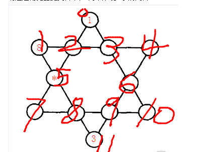

  

    /*
     * 如图【1.png】所示六角形中，填入1~12的数字。
     使得每条直线上的数字之和都相同。

```java
图中，已经替你填好了3个数字，请你计算星号位置所代表的数字是多少？
请通过浏览器提交答案，不要填写多余的内容。
*/
public class 六角填数 {
	public static void main(String[] args) {
		// TODO Auto-generated method stub
		long start = System.currentTimeMillis();
		// 从上到下,从左到右,依次为数组赋值
		int[] a = new int[12];
		a = init(a);// 初始化数组
		int[] temp = new int[12];
		for (int i = 0; i < temp.length; i++) {
			temp[i] = i + 1;
		}// 初始化1~12数据提供数组,如果使用了,那么值为其绝对值的负数

		dsf(0, a, temp);

		long end = System.currentTimeMillis();
		print("此程序运行,花费的时间是" + ((end - start) / 1000.0) + "秒.");
	}

	public static void print(Object o) {
		System.out.println(o.toString());
	}
	// 初始化数组
	public static int[] init(int[] a) {
		a[0] = 1;
		a[1] = 8;
		a[11] = 3;
		return a;
	}
	public static int[] calculate(int[] a) {
		int[] b = new int[6];
		b[0] = 1 + a[2] + a[5] + a[7];
		b[1] = 8 + a[2] + a[3] + a[4];
		b[2] = 11 + a[5] + a[8];
		b[3] = 1 + a[3] + a[6] + a[10];
		b[4] = a[7] + a[8] + a[9] + a[10];
		b[5] = a[4] + a[6] + a[9] + 3;

		return b;
	}
	public static boolean isOk(int[] b) {
		for (int i = 0; i < b.length; i++) {
			for (int j = i + 1; j < b.length; j++) {
				if (b[i] != b[j])
					return false;
			}
		}
		return true;
	}

	public static void dsf(int deep, int[] a, int[] temp) {
		if (deep == 12)// 表示第13层,也就是a的值已经赋值完毕
		{
			if (isOk(calculate(a))) {// int b[]=calculate(a);
				for (int i : a) {
					System.out.print(i + " ");
				}
				System.out.println();
			}
		} else {
			if (deep == 0 || deep == 1 || deep == 11) {
				dsf(deep + 1, a, temp);// 已经有的值,就不用再次赋值了
				return;
			}
			for (int i = 0; i < temp.length; i++) {
				if (i == 0 || i == 7 || i ==2) {//已经有的值,就不用再次赋值了
					continue;
				}
				if (temp[i] < 0)
					continue;
				a[deep] = temp[i];
				temp[i] = -temp[i];
				dsf(deep + 1, a, temp);
				temp[i] = -temp[i];
			}

		}

	}
}
```

运算结果:

1 8 9 2 7 10 12 6 5 4 11 3   
此程序运行,花费的时间是0.087秒.  
