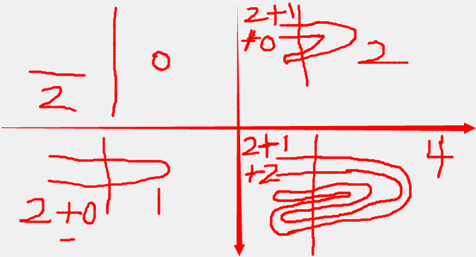

一根高筋拉面，中间切一刀，可以得到2根面条。   
如果先对折1次，中间切一刀，可以得到3根面条。  
如果连续对折2次，中间切一刀，可以得到5根面条。  

那么，连续对折10次，中间切一刀，会得到多少面条呢？

分析:

  

可以将此分为A和B两个部分;A部分代表有原始两头的那一方;

可以推断出,A部分每次的数量=原始两头+B部分折叠过来的数量

           总数量=A部分数量+B部分数量;

           通过分析可以知道B部分数量每次翻倍,而A部分中B部分的数量是依次累加的;

代码如下:

```java
public static void main(String[] args) {
		// TODO Auto-generated method stub
		long start = System.currentTimeMillis();
		int a=2,b=1;
		int temp=0;//每次从b方向折叠过来的数量;
		for(int i=2;i<=10;i++)
		{
			temp=temp+b;
			b=b*2;//b的数量每次翻倍
		}
		print(2+temp+b);
		long end = System.currentTimeMillis();
		print("此程序运行,花费的时间是" + ((end - start) / 1000.0) + "秒.");
	}

	public static void print(Object o) {
		System.out.println(o.toString());
	}
```

答案:1025
