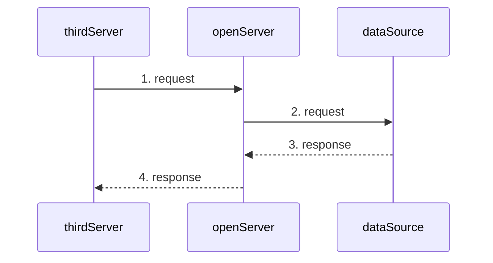

# 前言

此开放平台的设计文档分为上、中、下三篇来说明，分别对应概念与总体流程、关键逻辑、数据存储三部分。

# 需求简析

## 背景

企业之间需要数据交换，需要使用对方的功能时，如果规模较大，对接方比较多则需要有一个统一的对外的平台来完成这些功能。

此平台负责对外提供各种功能，提供标准化的交互规则和文档来方便多方数据对接。

## 功能点

一般而言，开放平台需要支持如下功能

- 支持认证与鉴权，主要需要对接入的第三方进行识别，以及不同接入方可以访问的不同接口权限、数据权限做核验。
- 支持数据隔离，不同接入方产生或访问的数据是隔离的，相互不影响。
- 方便可靠的接入方式、完善规范的接入文档
- 一般情况下，开放平台需要建立一个对外的 web网站或者app，来向第三方提供基本的应用管理、文档展示、公告通知等功能。
  - 如果没有这样的平台，则接入放需要联系开放平台工作人员来对接。

# 总体流程

## 访问流程

- thirdServer = 第三方服务，即接入方服务

- openServer = 开放平台的服务
- dataSource = 基础数据来源，可以是数据库或者微服务； 建议开放平台不直接操作和读取业务数据(库)，而是通过原有的数据、业务服务接口访问。

## 接入流程

一般而言接入分为客户端与服务端的接入，客户端类似于应用商店上架或者微信小程序这种上架，在使用对方客户端的工具或者遵循对应规则开发成品，然后将成品上次到对方平台。而服务端的接入一般指数据和接口访问的鉴权与校验等，这里主要说明服务端的接入。

### 基本概念

- 主体
  - 主体可以理解为是某一个第三方的公司/学校/平台，在一个主体下可以创建多个应用。
- 应用
  - 在开放平台的账号下可以创建应用，应用之间的数据和权限是独立的
  - 一个应用只能属于一个主体。
- 开发者
  - 在接入期间，需要一群程序员来开发程序，他们可能访问和编辑应用的相关信息，调试相关的功能，这些程序员就是开发者。
  - 被主体授权的开发者才有权限做和应用相关的操作。
  - 同一个开发者可以被多个主体授权，可以被授权操作多个应用；
    -  一个开发者可能关联多个应用，一个应用也可能关联多个开发者。 根据具体情况来设计授权的粒度。
- appKey
  - 唯一代表应用的标识符，有的平台也叫appId或者其它名称
- appSecret
  - 和appKey 一 一对应，用来认证鉴定身份，类似于应用的密码。
  - appSecret原则上不能泄露，如果泄露需要立即在开放平台重新生成，并使用新的值。
- openId
  - 用于唯一确定某  第三方**应用**下的 用户.
  - 对于其它实体，也可以映射为各种各样的openId； 例如用户所属的班级 classOpenId ；
- unionId
  - 用于唯一确定某 第三方**主体**下的  用户.
  - 对于其它实体，也可以映射为各种各样的unionId ；classUnionId等。

### 接入步骤

接入的步骤大同小异，可以根据具体情况调整、增减步骤。主要目标就是使用开放平台规定的方式来顺利访问和操作对应的数据。

1. 申请成开发者
2. 完善开发者对应的主体 信息，或者说创建一个主体，完善主体信息，联系开放平台审核
3. 开放平台审核主体信息
   1. 通过审核后会分配主体对应的账号
   2. 失败则表示资料有误，需要开发者重新修改提交
4. 开发者建立**应用** , 并获得对应的 appKey 和 appSecret . appKey将作为此 应用 的唯一标识 .
5. 配置 ip 白名单, 白名单外的 ip或域名 将禁止访问
   1. 在企业的服务间对接时，从安全考虑，将会做此限定
6. 申请**应用** 对应的 数据 / 模块 / 接口 的访问 权限 , 并等待审核通过
7. 开发者访问预留的测试接口 , 测试功能
   1. 按照访问规则组织好参数 , 访问给定的测试接口 , 测试访问是否成功  . 若成功则表示成功接入.

### API  文档

一般文档包含如下内容

- 接入指南
- 错误码定义
- api文档
  - 协议、域名、URL路径、参数说明、返回值说明
  - 不同语言的SDK信息
  - 接口频率限制说明
