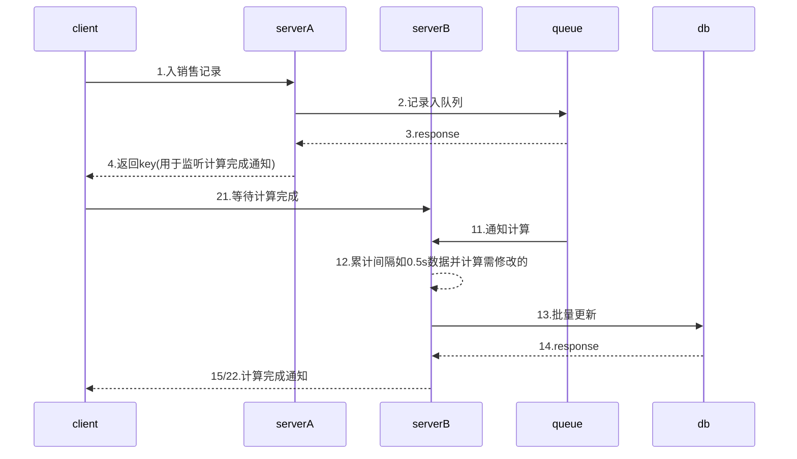

# 需求

以下为笔者在实际项目过程中的简化场景，主要描述维度预算和查询的相关思路，部分细节可忽略（比如其它基于数据维度的分库分表）。

## 简化场景

假设当前有一个销售平台

- 销售a、b、c、三种货物，后续可能销售其它货物

- 这三种货物由fa、fb、fc三家厂家生产，后续可能新增其它厂家

- 货物最终被销售网全国各地，已发货的货物认为售出

- 货物可能被退货，退货货物不计入售出

- 货物的销售数量非常大，售出 Max(并发)约 每秒 <= 200 , 总数据量年 约等于 1 亿

## 简化要求

ps： 实时 = 在极短时间内完成下列要求，一般在 2s以内。

- 需要实时查看某一个时间段内的某些厂家的某些货物的某些地区的销售数量数据
- 上诉中的某些 也可能为全部， 如某些厂家  也可能是 全部厂家
- 查询的时间精度到秒级别； 查询有并发要求，需大于 每秒 200 ，响应时间在2s内

# 简析

## 分析

- 如果走普通的SQL 实时统计全量数据，在一开始数据较小时可以满足需求，但是在数据量较大的时候，速度会下降很多，在并发增大后可以直接让数据库宕机
- 可否走全量的日级别的 T + 1的定时统计机制 ？
  - 考虑到退货是少数情况，大部分情况下的统计为售出的数量，只需要定时统计，后对退货和当日的数据特殊处理即可
  - 此方案不可行，数据量变大之后，组合的得到的结果数据量非常大，每晚跑定时统计任务效率极低；
- 增量按维度预算统计  + 按维度组合查询
  - 通过增量的方式来实时的累加数据，每次计算只需要动与此增量相关的部分，涉及的数据量变小，性能较高
  - 通过按照维度组合的方式查询数据，数据库中已经存储了部分维度的部分数据，此时条件中指定的维度后，可以直接获取相关数据，同样涉及的数据量较小，统计的性能较高

# 维度预算实战

由于统计的条件非常灵活，而且非常的多，做全量统计的数据量过大，同时性能较低，所以主要思路为将数据做部分统计，在查询的时候再根据条件做少量统计计算来得到最终的统计结果。

## 维度

这里的维度可以理解为查询时使用的各种条件，我们统计也是为了查询服务。以文章开头的场景举例，涉及的维度有（实际项目中一般具有更多的维度）：

- 货物种类
- 生产厂家
- 销售时间

统计的结果为 销售的数量， 查询条件均为上述几种维度的组合。

其中可以将维度分为两类
值类型是间断的，有限值或者数量较少的值的情况，例如货物种类； 范围类型，是连续的的一个区间，例如时间。

## 维度预算

### 值类型维度计算

我们已经分析了各种维度，当有销售的详情数据产生时，则实时增量将对应数据做更新。

假设当前有一张表具有以下字段， 其中对于值类型，0 = 当前维度的全部数据，1、2...表示维度内某个值对应的数据（比如货物种类 1 = 获取a，生产厂家2 = 厂家fb）。

| 货物种类 | 生产厂家 | 销售时间   | 销售数量 |
| -------- | -------- | ---------- | -------- |
| 0        | 0        | 2022-01-26 | 1019     |
| 1        | 2        | 2022-01-26 | 199      |

### 范围类型维度计算

对于范围类型，通常通常也需要按照范围来报错和计算，对于范围分割的方式有很多种，但是推荐从业务上来分割，假设场景中较多是按照年、月、日几种查询，则这里按照照此划分；同时为了方便存取，将范围类型维度划分到不同的表中（也可以以新增字段来区分，但是这样导致时间维度和其它维度在使用字段时不统一，需要对其特殊处理）

假设将时间分为三张表

按完整月（按年统计时由于一年仅有十二个月，计算量较小，所以在查询时累加即可，不对整年维度单独处理）

| 货物种类 | 生产厂家 | 销售时间(int) | 销售数量 |
| -------- | -------- | ------------- | -------- |
| 0        | 0        | 202201        | 1019     |
| 1        | 2        | 202202        | 199      |

按完整日

| 货物种类 | 生产厂家 | 销售时间(int) | 销售数量 |
| -------- | -------- | ------------- | -------- |
| 0        | 0        | 20220126      | 1019     |
| 1        | 2        | 20220126      | 199      |

详情表，精确到最小时间粒度

这里不记录数量，因为对详情表而言，每条记录就是一条销售数据；销售状态可以时出货，退货等

| 货物种类 | 生产厂家 | 销售时间(Date)      | 销售状态 |
| -------- | -------- | ------------------- | -------- |
| 1        | 2        | 2022-01-25 18:03:17 | 1        |
| 2        | 1        | 2022-01-25 18:04:17 | 2        |

当新增一条销售数据时，我们需要新增/修改的数据量为

```html
2 货物种类（全部 + 自身） *  2 生产厂家（全部 + 自身） * 3 时间维度 （月 + 日 + 详情） =  12 条记录
```

### 计算方案

通过维度预算时，其计算和存储的数据量大增，如果一旦有数据量变动就更新库，则性能相对较低； 实际工作中一般采用 详情数据走队列 + 间隔时间触发 + 内存计算 + 批量更新 + 结果通知 的方式来更新数据， 在要求不严格时队列和通知均可以使用redis来完成。考虑到业务查询和计算对服务器性能要求的不同，实际项目中可以考虑拆分为两类服务，分别充当查询节点和计算节点。



### 历史数据调整

对于退货这种会修改历史统计数据的，实际上可以转化为普通的维度统计行为，只是销售的数量从 +1 变为 -1即可。

### 并发预估

假设mysql 每秒插入数据最大 2000条/s，计算服务计算队列中数据的间隔为0.5s， 要求录入数据后需要在 2s 内计算得到结果，则当前并发预估为多少？

- 已知维度预算会使得更新的记录数量暴增，前文场景中，维度预算影响数量 = 12 ，则每秒最大录入 2000 / 12 条记录
- 假设平均一条记录录入后需要  0.5 / 2 = 0.25 s 后才开始计算， 因为响应时间为 2s ，所以最多有 2s - 0.25s = 1.75s
- 假设计算和网络传输、查询时间可忽略情况下，并发预计为 1.75s * 2000 / 12 , 大约 292

## 查询

### 值类型查询

值类型的查询比较简单，直接根据值在库中查询，之后累计计算结果即可，因为结果已经是部分统计过的，所以查询的数据量较小，性能可以接受。

### 范围类型查询

范围类型的查询需要按照区间来区分，通过区间来查询不同的表，在服务器中计算得到最终的数据。

例如查询 2021-11-25 15:03:17 到 2022-01-25 18:03:17 的数据，包含首尾时间，则需要将此范围拆分为月、日、日内详情三种维度来查询。

```html
2021-11-25 15:03:17 到 2022-01-25 18:03:17 的时间分解得到
整月：
    2021-12
整日：
    2021-11-26 ~ 2021-11-30
    2022-01-01 ~ 2022-01-24
日内：
    2021-11-25 15:03:17 ~ 2021-11-26 00:00:00(不包含)
    2022-01-25 00:00:00 ~ 2022-01-25 18:03:17
```

服务端在数据库中分别到三张表中查询对应的数据，然后聚合整理到一起，即可以得到最终的数据；

总体查询的数据量最大应该在 w条级别，在按日和按月查询时则只有几十条记录的聚合；如果日内数据的计算量依然极大，甚至可以将日内按照  按整小时和小时内的维度 再次拆分，以保证查询时的速度。
