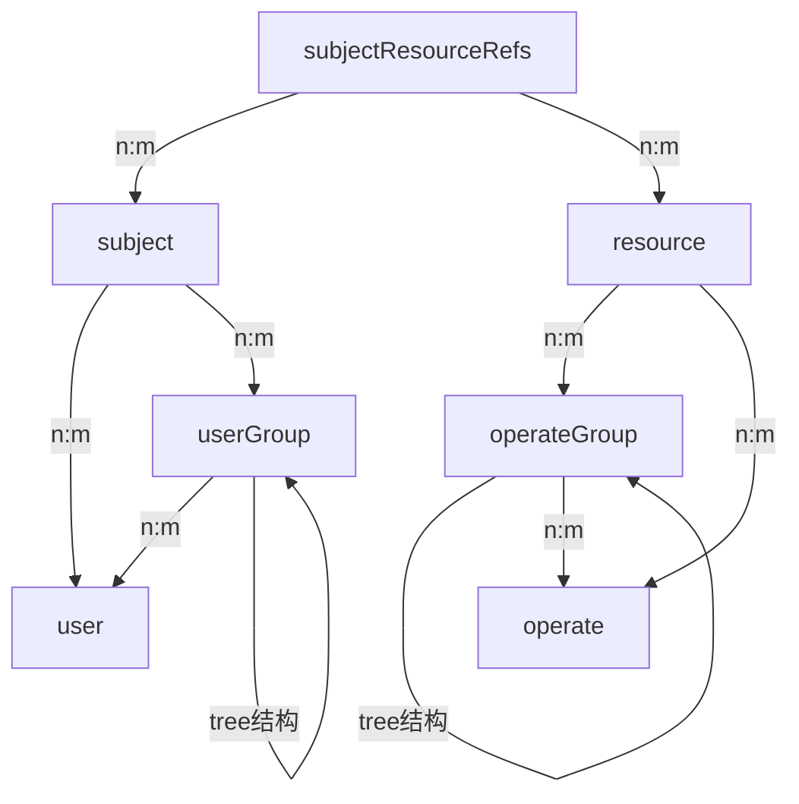
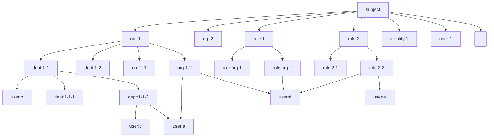
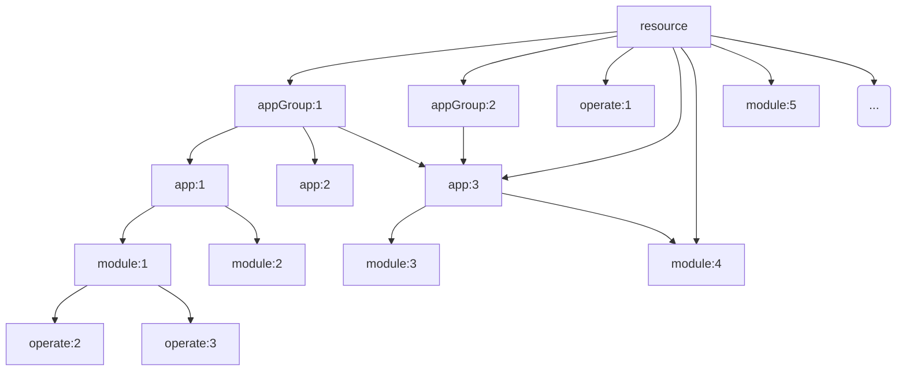
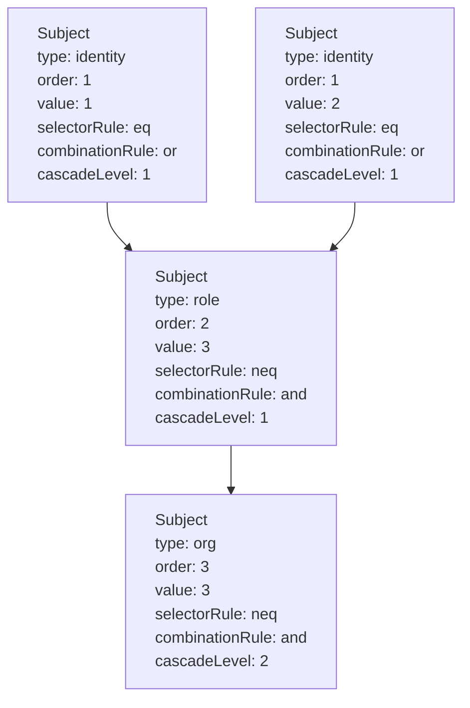
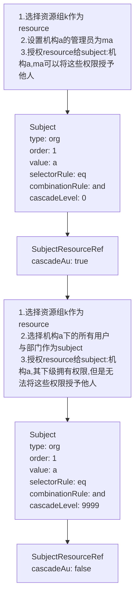

# 说明

本文主要对功能授权设计做详细说明，对于数据授权可以参考设计思路；

# 需求

## 原始需求

### 背景

- 假定一个系统，有自身的组织机构-部门，用户有各自的角色；

- 系统中存在多个应用套餐，一个应用套餐包含许多应用，一个应用包含很多模块，一个模块对应多个功能；
- 一个功能可能对应客户端的一个按钮或者功能，服务端的几个接口

### 需求

- 可以授权用户访问某个应用套餐、应用、模块、功能的权限
  - 若将应用权限授予用户，则此用户拥有此应用下的所有模块、功能的权限，通用具有此应用后续加入的功能的权限，无须重新授权， 以此类推
  - 若授予用户具有的应用、模块权限存在重合的情况，则取拥有权限的并集
- 可以像授予用户权限一样授予组织机构、角色访问某应用、功能这些权限
  - 若授予某个部门则部门下的所有用户均具有此权限，后续加入的部门的用户无须重新授权；但有时希望是此部门下的直属用户才具有这些权限，有时希望此部门的递归下级部门的用户全都具有这些权限；
  - 若授予角色，则通用如此
- 给某组织机构的管理员角色授予某些应用的权限，他们可以将这些权限中的一部分再次授予其当前组织机构下的某些用户

## 分析

- 应用、套餐这些都是对最小的可授权单位的一种归类，归类具有层级关系，可以统一抽象
- 操作最终是由用户来完成的，组织机构、角色、部门这些是对用户的一种归类，这些归类具有层级关系，可以统一抽象
- 授权行为就是将 可授权的单位 与  用户的归类关联起来，筛选时考虑关联是可以多对多的，选择需要足够的灵活，最后有一套自由组合的规则
- 授予权限的级联控制，即授予给用户A权限后，用户A是否可以将这些权限再授予B的控制

# 设计

- **资源 （resource）**：不论是功能还是其归类，还是具体的数据值亦或是其它，这些被授予的元素，统一抽象称为资源，其最小单位为 **操作**。
  - 对于资源的选择与组合，抽象为统一规则
- **主体 （subject）**：不论是用户还是其归类，还是具体的某个可以授予资源的元素，统一抽象称为主体，其最小单位为 **用户**。
  - 对于主体的选择与组合，抽象为统一规则
- **授权行为**：授权行为实际上就是对于资源与主体的关联关系，这些关联数据也可以称为**授权记录**，同时可以带上授予权限时的一些规则，例如级联授权的控制

总体结构：



对于subject的结构：



说明：

- 除user 外，其余的（org、dept这些）均为 userGroup的的一种，可通过类型标识来区分
- user 可以属于多个，属于任意的 userGroup
- userGroup 具有层级关系，每项都可以具有自身的类型，但是会受到所有父级层级的限定
  - eg： userGroupA的类型为 org，但是其父类型为 role，则其真实类型应该是  role-org 的有序联合类型；

对于resource的结构：



说明：

- 除 operate 外，其余的（app、module这些）均为 operateGroup 的一种，可通过类型标识来区分

- 与subject的规则类似，只是在业务上的类型所代表的意义不同；

# 详细设计

User：

```scala
id:Integer
userGroups:List<UserGroup>
```

UserGroup:

```scala
id:Integer
name:String
pid:Integer
level:Integer
path:String = "/1/23/44"
type:String = "org"
managerId:Integer
users:List<User>
```

- pid：父节点的id，如果没有父节点，可以使用 0 标识。
- type:  org/dept/role/identity/default ， 可以自定义各种类型（机构、部门、角色、身份等）
- managerId:  管理员id，即某个用户ID，可预设规则：当授权给某个用户组时，管理员默认具有此组下的所有权限

Subject:

```scala
id:Integer
type:String
value:Integer
order:Integer
selectorRule:String
combinationRule: String
cascadeLevel:Integer
```

说明：

- type: 可以是 user 、userGroup ,此时 value 值为当前type 对应的值，eg: type 是 user，则value 是 user的id。

- selectorRule = 筛选规则
  - 通过此规则可以方便筛选出目标范围，例如 筛选所有id大于3的，userGroup.type=org 的用户组
  - 预置规则： neq=不等 ；eq =等于； gt=大于； gl=小于；支持同时多个规则
- combinationRule = 不通 subject 的 ( selectorRule 筛选后的）数据组合方式
  - 预置规则： and 交集; or 并集;
- order: 升序（确定不同subject.combinationRule 计算的优先级），最后得到的就是最终的用户集合；
- cascadeLevel = 级联层级，标识筛选时向当前节点的上级或者下级挑选的层数；
  -  0 = 当前级别，当前节点;
  -  大于0  标识当前类型到其的下级的层级数，可以定义 9999 表示不限制向下层级值
  -  小于0 为当前层级向上的层级数，可以  -9999 表示不限制向上层级值
  -  可以定义 10000 为不限制向上或者向下层级值

对于特殊需求，筛选规则建议根据实际业务情况做扩展甚至改写，只需要有些字段记录下规则配合代码的保存与解析形成一个完整的筛选功能即可，可以按层存储，按照id关联主要是为方便做索引查询；

删选规则运行逻辑：

假设有一个规则是筛此用户必须是机构 3 的用户或者下级机构的用户；  用户身份id是1或者2，且用户角色部不等于3的用户；

我的得到的表达式如下： org in （3的下级，3的下下级）and role != 3 and ( identity in (1,2) )



Resource:

```scala
id:Integer
type:String
value:Integer
order:Integer
selectorRule:String
combinationRule: String
cascadeLevel:Integer
```

- Resource 的字段说明参考Subject

- type: 可以是 operate、operateGroup ,此时 value 值为当前type的

SubjectResourceRef:

```scala
id:Integer
subjects:List<Subject>
resources:List<Resource>
cascadeAu:Booean
```

- SubjectResourceRef 为授权记录，记录的是一些 resource 授予 subject的情况；

-  cascadeAu 标识是否可以级联授权，true = 被授予的subject 可以将这些拥有的 resource 授予下一个subject；false = 不能授予此次获得的 resource 给下一个subject

Operate:

```scala
id:Integer
urls:List<String>
code:String
```

- urls 一个操作可能需要服务端的接口配合，这里可以直接关联这些url
- code：唯一标识一个操作

OperateGroup:

```scala
id:Integer
pid:Integer
level:Integer
path:String = "/1/23/44"
type:String = "app"
operates:List<Operate>
```

# 说明

## 授权操作

1. 选择主体，确定规则，得到一批对象  Subject

2. 选择资源，确定规则，得到一批对象 Resource

3. 建立授权关系 ，保存SubjectResourceRef

## 案例

如何给机构授予权限，则其管理员具有所有权限，机构下用户默认没有权限，需要机构管理员单独授予后方具有对应权限？



说明：管理员只是一个标识，其具体的筛选与授权规则的控制方式仍然和普通用户一样，只是默认的值(cascadeAu 与 cascadeLevel ) 不同。

## 扩展

- 性能：如果筛选规则过于灵活，则其索引的难度必然加单，此时可以有两种方式来优化
  - 第一种是减少规则，减少后留下性能与灵活性折中的规则即可；通常对于大于、小于这类范围类型不推荐，因为索引难度增加，维护性降低
  - 第二种是数据固化，即不再固化规则，而是通过规则筛选出来数据后，固化到具体的id，这样查询时可以充分利用索引，但是需要考虑后续增量数据的处理

- 筛选规则：考虑到筛选规则的复杂性，甚至可以编码提供规则、数值占位符、与对应code，用户直接使用现有规则即可，这样性能更高，只是不够灵活; 角色组的管理员 默认具有管理组的所有权限
  - 例如可以定义一个规则 selectorRule = Odd， 此规则匹配所有 user 与 userGroup ，只要 其id值为奇数则拥有 resource，特殊定义的规则需要编码解析 。
- 对于 user 或者 operate，均可以自定义相关的属性来匹配业务做扩展
- 数据权限，可以参考现有功能权限的方式，但是数据权限通常和具体业务相关，很多需要自行扩展。
