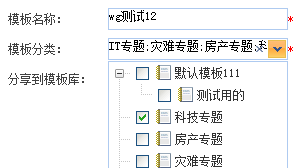
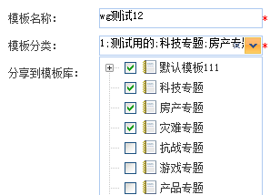

首先,直接后台传送tree的数据,然后前台控制哪些节点默认选中,存在bug,实例:

bug问题:无论设置的默认选中值是多少个,前台checkbox最多只显示选中一个,但是内容框中显示正常

默认选中的控制代码是:ligerComboBox的 selectValue(XXX)方法或者setValue(XXX)方法,显示情况如下;

  

```javascript
var tplName="<%=request.getAttribute("tplName")%>";
	var groupsNameString="<%=request.getAttribute("groupsNameString")%>"; 
var groupTree;
	$(function(){//获取当前项目分类的Tree           
		  groupTree=$("#groupName").ligerComboBox({
			 valueFieldID : 'id3',
	         textField: 'text',
	         selectBoxWidth: 178,
	         selectBoxHeight: '50%',
	         treeLeafOnly: false,
	         isShowCheckBox:true,
	         isMultiSelect:true,
	         tree : {
		url: 'topicTool!getLAPPComboxTempGroup.action?pid=0&tplId='+tplId,
		checkbox: true, 
		ajaxType: 'get',
	idFieldName :'id',
				textFieldName:'text',
				parentIDFieldName: 'pid',
			 },
			 onSelected:function (value,text){
	        	 $("#groupIds").val(value);	 
	         }
	    });
	    initCheckName();
		$.metadata.setType("attr", "validate");
	    ligerForm = $("#setForm").ligerForm();
		deafultValidate($("#setForm"));
	    Validator = $("#setForm").validate();
	    //初始化选中
	    if(groupIdsString!=null&&groupIdsString!="")
	    groupTree.selectValue('14;11;12');
	});
```

改变的方式:

         后台数据的格式(官方的Json格式如下):

```javascript
var data = [];

data.push({ id: 1, pid: 0, text: '1' });
data.push({ id: 2, pid: 1, text: '1.1' });
data.push({ id: 4, pid: 2, text: '1.1.2' });
data.push({ id: 5, pid: 2, text: '1.1.2' });      

data.push({ id: 10, pid: 8, text: 'wefwfwfe' });
data.push({ id: 11, pid: 8, text: 'wgegwgwg',, ischecked: true
});
data.push({ id: 12, pid: 8, text: 'gwegwg',ischecked: true
});

data.push({ id: 6, pid: 2, text: '1.1.3', ischecked: true });
data.push({ id: 7, pid: 2, text: '1.1.4' });
data.push({ id: 8, pid: 7, text: '1.1.5' });
data.push({ id: 9, pid: 7, text: '1.1.6' });

$(function ()
{
var tree = $("#tree1").ligerTree({  
data:data, 
idFieldName :'id',
slide : false,
parentIDFieldName :'pid'
});
treeManager = $("#tree1").ligerGetTreeManager();
treeManager.collapseAll();

});
```

但是如果只是在传送过来的数据中每个节点都直接加入ischecked:true;只是会导致tree选中,

但是LigerComboBox的内容框中没有内容;

这个时候只需要前台,再将选定的内容手动的设定就行了;

    combox.setText(groupsNameString);

同时手动初始化需要传送回去的数据:

```javascript
var tplId=<%=request.getAttribute("tplId")%>;
	var tplName="<%=request.getAttribute("tplName")%>";
	var groupsNameString="<%=request.getAttribute("groupsNameString")%>";
	var groupsIdString="<%=request.getAttribute("groupsIdString")%>";
var groupTree;
	$(function(){//获取当前项目分类的Tree           
		  groupTree=$("#groupName").ligerComboBox({
			 valueFieldID : 'id3',
	         textField: 'text',
	         selectBoxWidth: 178,
	         selectBoxHeight: '50%',
	         treeLeafOnly: false,
	         isShowCheckBox:true,
	         isMultiSelect:true,
	         tree : {
		url: 'topicTool!getLAPPComboxTempGroup.action?pid=0&tplId='+tplId,
		checkbox: true, 
		ajaxType: 'get',
	idFieldName :'id',
				textFieldName:'text',
				parentIDFieldName: 'pid',
			 },
			 onSelected:function (value,text){
	        	 $("#groupIds").val(value);
	         }
	    });
	    initCheckName();
		$.metadata.setType("attr", "validate");
	    ligerForm = $("#setForm").ligerForm();
		deafultValidate($("#setForm"));
	    Validator = $("#setForm").validate();   
	    //初始化选中内容test,同时手动初始化传送的id号码,
	     if(groupsNameString&&groupsNameString!=null&&groupsNameString!="")
	     groupTree.setText(groupsNameString);
	     $("#groupIds").val(groupsIdString);
	});
```

结果基本就能够正常使用了;

  

再次过程中需要注意的问题:

                        一:选中子节点,一定默认选中父节点;所以要更具当前节点找到其所有的父节点;

                        二:如果原来就选择了父节点,现在又按照一中加入了父节点,需要手动解决父节点的重复问题;
